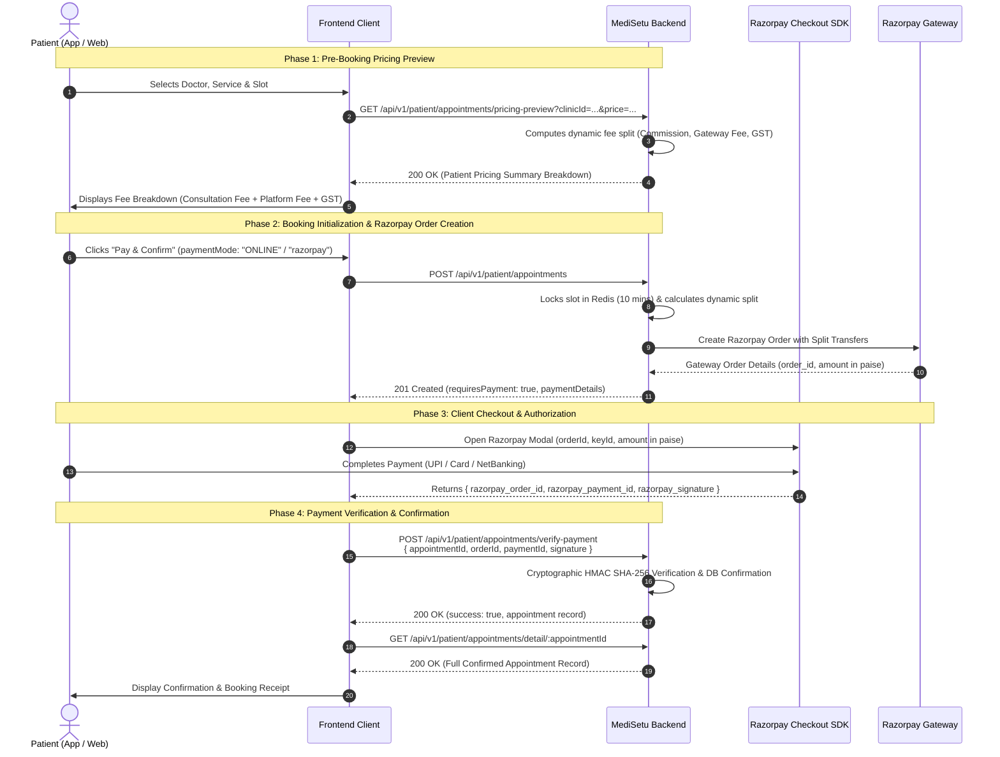

# Frontend Integration Guide: Razorpay Payment & Appointment Flow

**MediSetu Healthcare Platform**  
*Document Version: 3.0.0*  
*Target Gateway: Razorpay (Split Route & Direct Payments)*  
*Last Updated: 2026-09-02*

---

## 1. High-Level Flow Overview

MediSetu provides a mathematically sound, paise-precision payment processing architecture for doctor consultation bookings and clinic payments. The frontend application interacts with a unified API layer that calculates dynamic platform fee splits, locks doctor consultation slots in Redis, issues Razorpay checkout orders, and cryptographically verifies payment signatures.

The end-to-end booking and payment flow follows a 4-phase lifecycle:



---

## 2. API Reference & Contract Specifications

### 2.1. Pre-Booking Pricing Preview (Optional but Recommended)
Calculates the exact platform fee, applicable GST, and total payable amount before the user initiates payment.

* **Endpoint**: `GET /api/v1/patient/appointments/pricing-preview`
* **Authentication**: Bearer Token (`Authorization: Bearer <Patient_JWT>`)
* **Content-Type**: `application/json`

#### Query Parameters (`patientPricingPreviewQuerySchema`)

| Parameter | Type | Required | Description |
| :--- | :--- | :--- | :--- |
| `clinicId` | `UUID` | **Yes** | Target clinic ID |
| `price` | `string` | *Conditional* | Base consultation fee (e.g. `"500.00"`). Required if `clinicServiceId` or `doctorId` is not provided. |
| `clinicServiceId` | `UUID` | *Conditional* | Clinic service UUID to automatically resolve service price. |
| `doctorId` | `UUID` | *Conditional* | Doctor UUID to automatically resolve doctor consultation price. |

> [!NOTE]
> At least one of `price`, `clinicServiceId`, or `doctorId` must be provided.

#### Example Request
```http
GET /api/v1/patient/appointments/pricing-preview?clinicId=a1b2c3d4-e5f6-7a8b-9c0d-1e2f3a4b5c6d&price=500.00 HTTP/1.1
Authorization: Bearer eyJhbGciOi...
```

#### Response Payload (`200 OK`)
```json
{
  "status": "success",
  "message": "Appointment pricing preview calculated successfully",
  "data": {
    "consultationFee": 500,
    "consultationGst": 0,
    "platformFee": 61.18,
    "platformFeeGst": 11.01,
    "gstRate": 18,
    "totalPayable": 572.19,
    "currency": "INR"
  }
}
```

---

### 2.2. Create Booking & Initialize Razorpay Order
* **Endpoint**: `POST /api/v1/patient/appointments`
* **Authentication**: Bearer Token (`Authorization: Bearer <Patient_JWT>`)
* **Content-Type**: `application/json`

#### Request Payload (`IBookAppointmentRequest`)

```typescript
interface IBookAppointmentRequest {
  patientId: string;            // UUID of patient or linked family member (Required)
  doctorId: string;             // UUID of doctor (Required)
  clinicId: string;             // UUID of clinic (Required)
  clinicServiceId: string;      // UUID of consultation service (Required)
  appointmentDate: string;      // "YYYY-MM-DD" (Required)
  appointmentTime?: string | null; // "HH:mm" for slot-based clinics (Optional/Nullable)
  paymentMode?: 'ONLINE' | 'razorpay' | 'OFFLINE' | 'Pay Later'; // Use 'ONLINE' or 'razorpay' for Razorpay
  price?: string;               // Base service price as decimal string (e.g. "500.00")
  notes?: string;               // Optional consultation notes
  paymentNotes?: string;        // Optional payment remarks
}
```

> [!IMPORTANT]
> - `clinicServiceId` is **mandatory**. Omitting this field will result in a `400 Bad Request` validation error.
> - `tokenNo` is **not accepted** in the request body; token numbers are computed automatically on the backend.
> - For online payments, set `paymentMode: "ONLINE"` or `"razorpay"`. For pay-at-clinic, set `paymentMode: "OFFLINE"` or `"Pay Later"`.

#### Example Request
```json
{
  "patientId": "e3b0c442-98fc-1c14-9afb-4c8996fb9242",
  "doctorId": "7c9e6679-7425-40de-944b-e07fc1f90ae7",
  "clinicId": "a1b2c3d4-e5f6-7a8b-9c0d-1e2f3a4b5c6d",
  "clinicServiceId": "d8e3b123-5678-4321-9876-abcdef123456",
  "appointmentDate": "2026-09-10",
  "appointmentTime": "10:30",
  "paymentMode": "ONLINE",
  "price": "500.00",
  "notes": "Follow-up consultation"
}
```

---

#### Response A: Online Payment Required (`requiresPayment: true`)
When online payment is required, the slot is locked in Redis (`ttl = 600s`) and Razorpay checkout parameters are returned under `paymentDetails`.

* **Status**: `201 Created`

```json
{
  "status": "success",
  "message": "Appointment booking initiated. Payment required.",
  "data": {
    "appointment": {
      "id": "bfa24d83-4927-4638-b0a5-e83c076c8c91",
      "appointmentDate": "2026-09-10",
      "appointmentTime": "10:30",
      "tokenNo": null,
      "doctorId": "7c9e6679-7425-40de-944b-e07fc1f90ae7",
      "patientId": "e3b0c442-98fc-1c14-9afb-4c8996fb9242",
      "clinicId": "a1b2c3d4-e5f6-7a8b-9c0d-1e2f3a4b5c6d"
    },
    "requiresPayment": true,
    "paymentDetails": {
      "orderId": "order_Rz91823xKla98A",
      "amount": 57219,
      "currency": "INR",
      "keyId": "rzp_test_1DP5mmOlF5G5ag",
      "paymentProvider": "razorpay",
      "clientPayload": {
        "orderId": "order_Rz91823xKla98A",
        "keyId": "rzp_test_1DP5mmOlF5G5ag",
        "amount": 57219,
        "currency": "INR"
      },
      "pricingSummary": {
        "consultationFee": 500,
        "consultationGst": 0,
        "convenienceFee": 61.18,
        "convenienceFeeGst": 11.01,
        "gstRate": 18,
        "totalPayable": 572.19,
        "currency": "INR"
      }
    }
  }
}
```

> [!NOTE]
> * `paymentDetails.amount`: Total payable amount in **Paise** (e.g. `57219` = ₹572.19). Pass this directly into Razorpay options.
> * `paymentDetails.orderId`: Razorpay order ID to pass into Razorpay options.
> * `paymentDetails.keyId`: Razorpay Public Key ID to initialize the SDK.
> * `paymentDetails.pricingSummary`: Human-readable price and tax breakdown.

---

#### Response B: Offline Payment (Pay at Clinic / Pay Later)
When `requiresPayment === false`, the appointment is confirmed immediately in the database.

* **Status**: `201 Created`
```json
{
  "status": "success",
  "message": "Appointment booked successfully",
  "data": {
    "appointment": {
      "id": "c1a23456-7890-abcd-ef01-23456789abcd",
      "appointmentDate": "2026-09-10",
      "appointmentTime": "10:30",
      "tokenNo": 12,
      "appointmentStatus": "Confirmed",
      "paymentStatus": "Pending",
      "doctorId": "7c9e6679-7425-40de-944b-e07fc1f90ae7",
      "patientId": "e3b0c442-98fc-1c14-9afb-4c8996fb9242",
      "clinicId": "a1b2c3d4-e5f6-7a8b-9c0d-1e2f3a4b5c6d"
    },
    "requiresPayment": false
  }
}
```

---

### 2.3. Verify Payment & Confirm Appointment
* **Endpoint**: `POST /api/v1/patient/appointments/verify-payment`
* **Authentication**: Bearer Token (`Authorization: Bearer <Patient_JWT>`)
* **Content-Type**: `application/json`

#### Request Payload (`IVerifyPaymentRequest`)

```typescript
interface IVerifyPaymentRequest {
  appointmentId: string;       // Temporary booking UUID returned in Step 2.2
  orderId: string;             // Razorpay Order ID (from razorpay_order_id)
  paymentId: string;           // Razorpay Payment ID (from razorpay_payment_id)
  signature: string;           // Razorpay Signature (from razorpay_signature)
}
```

> [!CAUTION]
> The backend schema validates **camelCase** keys: `appointmentId`, `orderId`, `paymentId`, and `signature`. Map the SDK's snake_case return values (`razorpay_order_id`, `razorpay_payment_id`, `razorpay_signature`) to these camelCase fields before posting to the backend.

#### Example Request
```json
{
  "appointmentId": "bfa24d83-4927-4638-b0a5-e83c076c8c91",
  "orderId": "order_Rz91823xKla98A",
  "paymentId": "pay_Rz923Kjsdf98A",
  "signature": "9efb0a701938bc4f3a7c61928374619283746192837461928374619283746192"
}
```

#### Response Payload (`200 OK`)
```json
{
  "status": "success",
  "message": "Payment verified successfully",
  "data": {
    "success": true,
    "message": "Payment verified and appointment confirmed successfully",
    "data": {
      "appointmentId": "e7b1a234-5678-90ab-cdef-1234567890ab",
      "appointment": {
        "id": "e7b1a234-5678-90ab-cdef-1234567890ab",
        "appointmentDate": "2026-09-10",
        "appointmentTime": "10:30",
        "tokenNo": 14,
        "appointmentStatus": "Confirmed",
        "doctorId": "7c9e6679-7425-40de-944b-e07fc1f90ae7",
        "patientId": "e3b0c442-98fc-1c14-9afb-4c8996fb9242",
        "clinicId": "a1b2c3d4-e5f6-7a8b-9c0d-1e2f3a4b5c6d"
      }
    }
  }
}
```

---

### 2.4. Fetch Full Appointment Details & Receipt
* **Endpoint**: `GET /api/v1/patient/appointments/detail/:appointmentId`
* **Authentication**: Bearer Token (`Authorization: Bearer <Patient_JWT>`)

Returns the full confirmed appointment record with doctor details, clinic address, assigned token number, payment status, and invoice information.

---

### 2.5. Cancellation Policy & Cancellation API

#### A. Fetch Cancellation Policy
* **Endpoint**: `GET /api/v1/patient/appointments/cancellation-policy`
* **Query**: `?clinicId=<clinicUuid>` or `?doctorId=<doctorUuid>`

```json
{
  "status": "success",
  "message": "Cancellation policy fetched successfully",
  "data": {
    "clinicPolicy": {
      "cancellationWindowHours": 2,
      "refundPercentage": 100,
      "cancellationFee": 0
    },
    "applicationPolicy": {
      "allowPatientCancellation": true,
      "minimumLeadTimeHours": 1
    }
  }
}
```

#### B. Cancel Appointment (with Automatic Refund Processing)
* **Endpoint**: `POST /api/v1/patient/appointments/:appointmentId/cancel`
* **Content-Type**: `application/json`

##### Request Payload:
```json
{
  "reason": "Personal Emergency",
  "cancelReasonNotes": "Unable to attend at the scheduled time."
}
```

##### Response (`200 OK`):
```json
{
  "status": "success",
  "message": "Appointment cancelled successfully. Refund initiated if eligible.",
  "data": {
    "appointmentId": "e7b1a234-5678-90ab-cdef-1234567890ab",
    "appointmentStatus": "Cancelled",
    "refundStatus": "INITIATED",
    "refundAmount": 500.00
  }
}
```

---

### 2.6. Reschedule Appointment
* **Endpoint**: `PUT /api/v1/patient/appointments/:appointmentId`
* **Content-Type**: `application/json`

#### Request Payload:
```json
{
  "appointmentDate": "2026-09-15",
  "appointmentTime": "11:00",
  "comments": "Rescheduled due to work meeting"
}
```

---

## 3. Web Frontend Integration (React / Next.js)

### 3.1. Add Razorpay Checkout Script
Include the Razorpay Checkout SDK script in your `index.html` or Next.js `_document.tsx` / `layout.tsx`:

```html
<!-- Razorpay Checkout SDK -->
<script src="https://checkout.razorpay.com/v1/checkout.js"></script>
```

---

### 3.2. Ready-to-Use React Hook (`useRazorpayCheckout.ts`)

```typescript
// src/hooks/useRazorpayCheckout.ts
import { useState } from 'react';
import axios from 'axios';

export interface PatientPrefill {
  name: string;
  email: string;
  phone: string;
}

export interface BookingPayload {
  patientId: string;
  doctorId: string;
  clinicId: string;
  clinicServiceId: string;
  appointmentDate: string;
  appointmentTime?: string | null;
  paymentMode?: 'ONLINE' | 'razorpay' | 'OFFLINE';
  price?: string;
  notes?: string;
  paymentNotes?: string;
}

export interface PricingSummary {
  consultationFee: number;
  consultationGst: number;
  platformFee: number;
  platformFeeGst: number;
  gstRate: number;
  totalPayable: number;
  currency: string;
}

export const useRazorpayCheckout = () => {
  const [loading, setLoading] = useState(false);
  const [error, setError] = useState<string | null>(null);

  /**
   * 1. Pre-booking pricing preview
   */
  const getPricingPreview = async (
    clinicId: string,
    price?: string,
    clinicServiceId?: string
  ): Promise<PricingSummary | null> => {
    try {
      const res = await axios.get('/api/v1/patient/appointments/pricing-preview', {
        params: { clinicId, price, clinicServiceId },
      });
      return res.data.data;
    } catch (err: any) {
      console.error('Failed to fetch pricing preview', err);
      return null;
    }
  };

  /**
   * 2. Triggers booking creation and launches Razorpay Checkout Modal
   */
  const processBookingAndPayment = async (
    bookingPayload: BookingPayload,
    patient: PatientPrefill,
    onSuccess: (appointmentId: string) => void,
    onFailure: (errorMessage: string) => void
  ) => {
    try {
      setLoading(true);
      setError(null);

      // Step 1: Initialize booking on backend
      const res = await axios.post('/api/v1/patient/appointments', bookingPayload);
      const { appointment, requiresPayment, paymentDetails } = res.data.data;

      // If offline payment (Pay at Clinic), confirmed immediately
      if (!requiresPayment) {
        setLoading(false);
        onSuccess(appointment.id);
        return;
      }

      // Step 2: Configure Razorpay Checkout options
      const options = {
        key: paymentDetails.keyId,
        amount: paymentDetails.amount, // in paise
        currency: paymentDetails.currency || 'INR',
        name: 'MediSetu Healthcare',
        description: 'Doctor Consultation Booking',
        order_id: paymentDetails.orderId,
        prefill: {
          name: patient.name,
          email: patient.email,
          contact: patient.phone,
        },
        theme: {
          color: '#0F766E', // MediSetu Primary Brand Color
        },
        handler: async (razorpayResponse: {
          razorpay_payment_id: string;
          razorpay_order_id: string;
          razorpay_signature: string;
        }) => {
          try {
            setLoading(true);
            // Step 3: Verify signature with backend camelCase schema
            const verifyRes = await axios.post(
              '/api/v1/patient/appointments/verify-payment',
              {
                appointmentId: appointment.id,
                orderId: razorpayResponse.razorpay_order_id,
                paymentId: razorpayResponse.razorpay_payment_id,
                signature: razorpayResponse.razorpay_signature,
              }
            );

            setLoading(false);
            const confirmedId =
              verifyRes.data.data?.data?.appointmentId || appointment.id;
            onSuccess(confirmedId);
          } catch (verifyErr: any) {
            setLoading(false);
            const msg =
              verifyErr.response?.data?.message ||
              'Payment verification failed. Please contact support.';
            setError(msg);
            onFailure(msg);
          }
        },
        modal: {
          ondismiss: () => {
            setLoading(false);
            onFailure('Payment checkout was cancelled by user.');
          },
        },
      };

      // Step 4: Open Razorpay modal
      const rzp = new (window as any).Razorpay(options);
      rzp.on('payment.failed', (resp: any) => {
        setLoading(false);
        const errMsg = resp.error?.description || 'Payment Failed';
        setError(errMsg);
        onFailure(errMsg);
      });
      rzp.open();
    } catch (err: any) {
      setLoading(false);
      const msg =
        err.response?.data?.message || err.message || 'Booking initiation failed';
      setError(msg);
      onFailure(msg);
    }
  };

  return { processBookingAndPayment, getPricingPreview, loading, error };
};
```

---

### 3.3. React Booking Modal Component (`AppointmentBookingModal.tsx`)

```tsx
// src/components/AppointmentBookingModal.tsx
import React, { useEffect, useState } from 'react';
import {
  useRazorpayCheckout,
  BookingPayload,
  PatientPrefill,
  PricingSummary,
} from '../hooks/useRazorpayCheckout';

interface AppointmentModalProps {
  doctor: {
    id: string;
    name: string;
    clinicId: string;
    clinicServiceId: string;
    consultationFee: number;
  };
  slot: {
    date: string; // "YYYY-MM-DD"
    time: string; // "HH:mm"
  };
  patient: {
    id: string;
    fullName: string;
    email?: string;
    phone: string;
  };
  onClose: () => void;
  onBookingConfirmed: (appointmentId: string) => void;
}

export const AppointmentBookingModal: React.FC<AppointmentModalProps> = ({
  doctor,
  slot,
  patient,
  onClose,
  onBookingConfirmed,
}) => {
  const { processBookingAndPayment, getPricingPreview, loading, error } =
    useRazorpayCheckout();
  const [pricing, setPricing] = useState<PricingSummary | null>(null);

  // Fetch dynamic convenience fee and GST breakdown on mount
  useEffect(() => {
    getPricingPreview(
      doctor.clinicId,
      String(doctor.consultationFee),
      doctor.clinicServiceId
    ).then((res) => {
      if (res) setPricing(res);
    });
  }, [doctor]);

  const handlePayAndBook = () => {
    const bookingPayload: BookingPayload = {
      patientId: patient.id,
      doctorId: doctor.id,
      clinicId: doctor.clinicId,
      clinicServiceId: doctor.clinicServiceId,
      appointmentDate: slot.date,
      appointmentTime: slot.time,
      paymentMode: 'ONLINE',
      price: String(doctor.consultationFee),
      notes: 'Doctor consultation booking',
    };

    const patientPrefill: PatientPrefill = {
      name: patient.fullName,
      email: patient.email || 'patient@medisetu.com',
      phone: patient.phone,
    };

    processBookingAndPayment(
      bookingPayload,
      patientPrefill,
      (appointmentId) => {
        onBookingConfirmed(appointmentId);
      },
      (errorMessage) => {
        console.error('Booking failed:', errorMessage);
      }
    );
  };

  return (
    <div className="booking-modal">
      <h3>Confirm Appointment</h3>
      <p><strong>Doctor:</strong> {doctor.name}</p>
      <p><strong>Slot:</strong> {slot.time} on {slot.date}</p>

      {/* Financial Breakdown Table */}
      <div className="price-breakdown">
        <h4>Payment Summary</h4>
        <div className="row">
          <span>Consultation Fee:</span>
          <span>₹{pricing ? pricing.consultationFee.toFixed(2) : doctor.consultationFee.toFixed(2)}</span>
        </div>
        {pricing && pricing.platformFee > 0 && (
          <div className="row">
            <span>Platform Fee:</span>
            <span>₹{pricing.platformFee.toFixed(2)}</span>
          </div>
        )}
        {pricing && pricing.platformFeeGst > 0 && (
          <div className="row">
            <span>GST ({pricing.gstRate}%):</span>
            <span>₹{pricing.platformFeeGst.toFixed(2)}</span>
          </div>
        )}
        <hr />
        <div className="row total">
          <strong>Total Payable:</strong>
          <strong>
            ₹{pricing ? pricing.totalPayable.toFixed(2) : doctor.consultationFee.toFixed(2)}
          </strong>
        </div>
      </div>

      {error && <div className="error-message">{error}</div>}

      <div className="actions">
        <button onClick={onClose} disabled={loading}>
          Cancel
        </button>
        <button onClick={handlePayAndBook} disabled={loading} className="btn-primary">
          {loading ? 'Processing Payment...' : 'Pay & Confirm Appointment'}
        </button>
      </div>
    </div>
  );
};
```

---

## 4. Mobile App Integration (React Native)

For mobile applications, install `react-native-razorpay`:

```bash
npm install react-native-razorpay
```

### React Native Checkout Handler (`mobileRazorpayService.ts`)

```typescript
// src/services/mobileRazorpayService.ts
import RazorpayCheckout from 'react-native-razorpay';
import axios from 'axios';

export const handleMobileRazorpayBooking = async (
  bookingPayload: {
    patientId: string;
    doctorId: string;
    clinicId: string;
    clinicServiceId: string;
    appointmentDate: string;
    appointmentTime?: string;
    paymentMode: 'ONLINE' | 'razorpay';
    price: string;
    notes?: string;
  },
  patient: {
    name: string;
    email: string;
    phone: string;
  },
  navigation: any
) => {
  try {
    // 1. Initialize booking on backend
    const res = await axios.post('/api/v1/patient/appointments', bookingPayload);
    const { appointment, requiresPayment, paymentDetails } = res.data.data;

    if (!requiresPayment) {
      navigation.navigate('BookingSuccess', { appointmentId: appointment.id });
      return;
    }

    // 2. Configure Native Razorpay Checkout
    const options = {
      description: 'Doctor Consultation Booking',
      currency: paymentDetails.currency || 'INR',
      key: paymentDetails.keyId,
      amount: paymentDetails.amount, // in paise
      order_id: paymentDetails.orderId,
      prefill: {
        email: patient.email,
        contact: patient.phone,
        name: patient.name,
      },
      theme: { color: '#0F766E' },
    };

    try {
      const data = await RazorpayCheckout.open(options);
      // 3. Verify payment signature
      const verifyRes = await axios.post('/api/v1/patient/appointments/verify-payment', {
        appointmentId: appointment.id,
        orderId: data.razorpay_order_id,
        paymentId: data.razorpay_payment_id,
        signature: data.razorpay_signature,
      });

      const confirmedId =
        verifyRes.data.data?.data?.appointmentId || appointment.id;
      navigation.navigate('BookingSuccess', { appointmentId: confirmedId });
    } catch (sdkError: any) {
      console.warn('Razorpay checkout cancelled or failed', sdkError);
    }
  } catch (err: any) {
    console.error('Booking initialization failed', err.response?.data || err);
  }
};
```

---

## 5. Edge Cases & Resilience Engineering

1. **Network Drop After UPI Payment (Webhook Rescue)**:
   * If the patient closes the browser/app right after entering their UPI PIN, Razorpay emits `payment.captured` directly to the backend webhook (`POST /api/v1/patient/appointments/webhook`).
   * The backend validates the webhook signature, creates the appointment in the database, maps the temporary booking ID (`temp_booking_mapped:<appointmentId>`), and releases the slot lock. When the user reopens the app, their appointment will show as **Confirmed**.
2. **10-Minute Lock Expiry & Late Payment Handling (409 Conflict Rescue)**:
   * The backend reserves the doctor slot in Redis for 10 minutes (`PAYMENT_LOCK_TTL_SECONDS = 600s`).
   * If the patient takes longer than 10 minutes and another patient claims the slot before payment verification completes, the backend automatically creates a `Cancelled` appointment with `refundNotes: "Refund Required: Slot occupied by another booking"` and logs financial ledger entries for automated refund processing.
3. **Double-Click & Concurrent Payment Protection**:
   * The backend uses idempotency locking on `(sourceType, checkoutReferenceId)`. Clicking the "Pay" button multiple times safely returns the existing active order without double charging.

---

## 6. Testing & Razorpay Sandbox Cards

When testing in Razorpay Sandbox:
* **UPI**: Enter `success@razorpay` for immediate success or `failure@razorpay` to simulate failure.
* **Cards**: Use any 16-digit test card number (e.g. `4111 1111 1111 1111`, expiry `12/30`, CVV `123`), enter any OTP (`123456`) on the bank page.
* **NetBanking**: Select any bank and click **Success** or **Failure** on the simulated bank gateway page.
