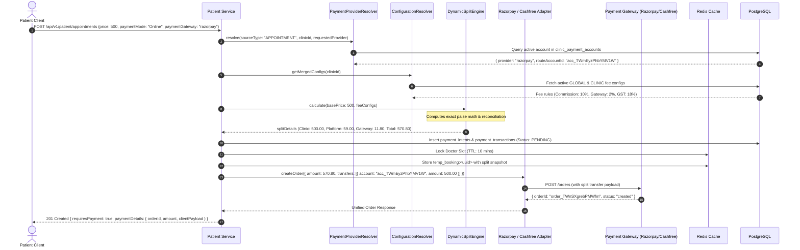
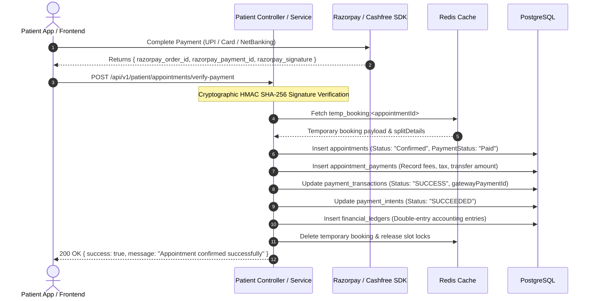

# Multi-Gateway Payment Architecture & Split Engine Specification

**MediSetu Healthcare Management Platform**  
*Document Version: 1.0.0*  
*Last Updated: 2026-09-01*

---

## 1. Executive Overview

The **MediSetu Multi-Gateway Payment System** provides a pluggable, highly resilient, and mathematically sound financial processing pipeline. It decouples the core appointment and subscription domains from underlying payment gateway vendors (**Razorpay**, **Cashfree**, **Stripe**).

### Key Architectural Capabilities
1. **Strategy Pattern Gateway Abstraction**: Dynamic runtime selection of payment providers via a common `IPaymentAdapter` contract.
2. **Unified Sub-Merchant Linked Accounts**: Consolidated sub-merchant tracking (`clinic_payment_accounts`) supporting multi-gateway routing per clinic.
3. **Paise-Precision Split Engine**: High-precision calculation engine operating exclusively with integer paise math, eliminating floating-point rounding errors.
4. **SCD Type 2 Dynamic Fee Configuration**: Version-controlled polymorphic fee rules supporting Global platform defaults and Clinic-specific overrides (`fee_config_versions`).
5. **Micro-Reconciliation Invariant Guarantee**: Every order strictly enforces:
   $$\text{Patient Total} = \text{Clinic Share} + \text{Platform Commission} + \text{Gateway Fee} + \text{GST/Tax}$$
6. **Dual-Mode Operation**: Seamlessly toggles between **Direct Centralized Platform Payments** and **Split Sub-Merchant Routing** via environment feature flags (`ENABLE_RAZORPAY_ROUTE`).

---

## 2. System Architecture & Components

```
                      ┌────────────────────────────────────────────────────────┐
                      │                 Client Layer                           │
                      │  (Patient Mobile App / Doctor Web / Postman / SDK)     │
                      └──────────────────────────┬─────────────────────────────┘
                                                 │
                                                 ▼
                      ┌────────────────────────────────────────────────────────┐
                      │              Patient / Clinic Controllers              │
                      └──────────────────────────┬─────────────────────────────┘
                                                 │
                                                 ▼
┌──────────────────────────────────────────────────────────────────────────────────────────────┐
│                                    Payment Service Layer                                     │
│                                                                                              │
│   ┌─────────────────────────────┐                    ┌──────────────────────────────────┐   │
│   │   PaymentProviderResolver   │                    │      ConfigurationResolver       │   │
│   │  - Resolves Target Provider │                    │  - Merges Global Defaults &      │   │
│   │  - Checks Sub-Merchant Link │                    │    Clinic Specific Overrides     │   │
│   │  - Checks Feature Flags     │                    │  - Fetches SCD Type 2 Active Fees│   │
│   └──────────────┬──────────────┘                    └────────────────┬─────────────────┘   │
│                  │                                                    │                      │
│                  └───────────────────────┬────────────────────────────┘                      │
│                                          │                                                   │
│                                          ▼                                                   │
│                        ┌──────────────────────────────────┐                                  │
│                        │        DynamicSplitEngine        │                                  │
│                        │  - Calculates Exact Integer Math │                                  │
│                        │  - Reconciles Deductions/Markups │                                  │
│                        │  - Produces Financial Breakdown  │                                  │
│                        └─────────────────┬────────────────┘                                  │
│                                          │                                                   │
│                                          ▼                                                   │
│                        ┌──────────────────────────────────┐                                  │
│                        │      PaymentStrategyFactory      │                                  │
│                        └─────────────────┬────────────────┘                                  │
│                                          │                                                   │
│                  ┌───────────────────────┴────────────────────────┐                          │
│                  ▼                                                ▼                          │
│   ┌─────────────────────────────┐                  ┌─────────────────────────────┐           │
│   │       RazorpayAdapter       │                  │       CashfreeAdapter       │           │
│   │  - Standard Orders          │                  │  - Easy Split Orders        │           │
│   │  - Route Split Transfers    │                  │  - Vendor Settlements       │           │
│   │  - Webhook Verification     │                  │  - Webhook Verification     │           │
│   └──────────────┬──────────────┘                  └──────────────┬──────────────┘           │
└──────────────────┼────────────────────────────────────────────────┼──────────────────────────┘
                   │                                                │
                   ▼                                                ▼
       ┌────────────────────────┐                      ┌────────────────────────┐
       │     Razorpay APIs      │                      │     Cashfree APIs      │
       └────────────────────────┘                      └────────────────────────┘
```

---

## 3. Database Schema & Data Models

### 3.1. Unified Sub-Merchant Accounts (`clinic_payment_accounts`)
Consolidates linked vendor accounts across all gateway providers.

| Column | Type | Description |
| :--- | :--- | :--- |
| `id` | `UUID (PK)` | Unique record ID |
| `clinic_id` | `UUID (FK)` | Clinic reference |
| `payment_provider` | `VARCHAR(50)` | Gateway identifier (`razorpay`, `cashfree`, `stripe`) |
| `gateway_account_id` | `VARCHAR(255)` | Sub-merchant account ID (`acc_...` for Razorpay, `vendor_...` for Cashfree) |
| `gateway_stakeholder_id` | `VARCHAR(255)` | Stakeholder ID (for Razorpay Route onboarding) |
| `route_status` | `VARCHAR(50)` | `DRAFT` \| `PENDING` \| `ACTIVE` \| `SUSPENDED` \| `NEEDS_CLARIFICATION` |
| `route_onboarded_at` | `TIMESTAMP` | Timestamp when sub-merchant account became active |
| `route_onboarding_rejection_reason` | `TEXT` | Failure/rejection remarks from KYC |
| `onboarding_draft_data` | `TEXT` | Raw draft form JSON during onboarding |

> **Compound Constraint**: Unique index on `(clinic_id, payment_provider)` allows one account per provider per clinic while permitting multiple clinics to link to the same `gateway_account_id`.

---

### 3.2. Dynamic Fee Configurations (`fee_config_versions`)
Stores polymorphic fee rules with Slow Changing Dimension (SCD Type 2) tracking.

| Column | Type | Description |
| :--- | :--- | :--- |
| `id` | `UUID (PK)` | Version ID |
| `scope` | `VARCHAR(20)` | `GLOBAL` (Platform default) or `CLINIC` (Clinic override) |
| `clinic_id` | `UUID (FK, Nullable)` | Clinic reference if `scope = 'CLINIC'` |
| `fee_type` | `VARCHAR(50)` | `CLINIC_COMMISSION` \| `CONVENIENCE_FEE` \| `GATEWAY_FEE` \| `ROUTE_TRANSFER_FEE` |
| `calculation_method`| `VARCHAR(20)` | `PERCENTAGE` \| `FIXED` \| `TIERED` |
| `calculation_base` | `VARCHAR(50)` | `CLINIC_SERVICE_PRICE` \| `PRE_GATEWAY_SUBTOTAL` \| `TOTAL_TRANSACTION_VALUE` |
| `rate_or_amount` | `NUMERIC(12,4)` | Fee percentage (e.g. `2.0000` = 2%, `10.0000` = 10%) or fixed INR amount (e.g. `50.0000`) |
| `tax_rate` | `NUMERIC(5,2)` | Applicable GST rate percentage (e.g. `18.00` = 18% GST) |
| `tax_treatment` | `VARCHAR(20)` | `TAX_EXCLUSIVE` (Tax added on top) \| `TAX_INCLUSIVE` |
| `fee_payer` | `VARCHAR(20)` | `PATIENT` (Patient bears the fee) \| `CLINIC` (Deducted from clinic share) |
| `fee_recipient` | `VARCHAR(20)` | `PLATFORM` \| `GATEWAY` \| `CLINIC` |
| `deduction_strategy`| `VARCHAR(30)` | `ADD_TO_PATIENT_TOTAL` \| `DEDUCT_FROM_CLINIC_PAYOUT` |
| `is_active` | `BOOLEAN` | Active version flag |

> **Runtime Resolution & Fail-Fast Guarantee (`ConfigurationResolver`)**:
> 1. **Hierarchy**: Clinic-specific overrides (`scope = 'CLINIC'`) strictly supersede Global defaults (`scope = 'GLOBAL'`) via SQL `DISTINCT ON (fee_type)` ordering by `(clinic_id IS NOT NULL) DESC, version DESC`.
> 2. **Temporal Windowing**: Only active rows (`is_active = true`) where `effective_from <= NOW()` and `(effective_to IS NULL OR effective_to >= NOW())` are selected.
> 3. **Fail-Fast Integrity**: If the database lacks active fee configurations (e.g. unseeded database), `ConfigurationResolver` throws an explicit exception rather than returning static fallbacks to prevent financial calculation drift or silent 0-commission losses.

---

### 3.3. Payment Intents & Transactions (`payment_intents`, `payment_transactions`)

* **`payment_intents`**: High-level idempotent checkout session.
  - `status`: `REQUIRES_PAYMENT` $\rightarrow$ `SUCCEEDED` / `FAILED` / `CANCELLED`.
  - `financial_snapshot`: JSON capturing exact active fee configuration and price breakdown at the time of order creation.
* **`payment_transactions`**: Concrete payment gateway execution.
  - `gateway_order_id`, `gateway_payment_id`, `payment_provider`.
  - `amount`, `clinic_amount`, `platform_fee`, `gateway_fee`, `tax_amount`, `transferred_amount`.
  - `status`: `PENDING` $\rightarrow$ `SUCCESS` / `FAILED` / `REFUNDED`.

---

## 4. End-to-End Flows

### 4.1. Online Appointment Booking & Checkout (Split Route Mode)



---

### 4.2. Payment Verification & Confirmation Flow



---

## 5. Mathematical Specification of the Split Engine

### 5.1. The Reconciliation Invariant
For every transaction of Base Consultation Price $P_{\text{base}}$:

$$\text{Patient Total Price } (TP) = C_{\text{clinic}} + F_{\text{platform}} + F_{\text{gateway}} + T_{\text{gst}}$$

### 5.2. Standard Healthcare Business Rules (Patient-Borne Model)

1. **Clinic Share ($C_{\text{clinic}}$)**:
   - Receives **100% of base price**: $C_{\text{clinic}} = P_{\text{base}}$
2. **Platform Commission ($F_{\text{platform}}$)**:
   - Base Commission: $M_{\text{comm}} = \text{round}(P_{\text{base}} \times r_{\text{comm}})$
   - Commission GST (18%): $T_{\text{comm}} = \text{round}(M_{\text{comm}} \times 0.18)$
   - Total Platform Payout = $M_{\text{comm}} + T_{\text{comm}}$
3. **Gateway Fee ($F_{\text{gateway}}$)**:
   - Computed on Pre-Gateway Subtotal: $S_{\text{pre}} = P_{\text{base}} + (M_{\text{comm}} + T_{\text{comm}})$
   - Base Gateway Charge: $M_{\text{gw}} = \text{round}(S_{\text{pre}} \times r_{\text{gw}})$
   - Gateway GST (18%): $T_{\text{gw}} = \text{round}(M_{\text{gw}} \times 0.18)$
   - Total Gateway Cost = $M_{\text{gw}} + T_{\text{gw}}$
4. **Final Patient Payable ($TP$)**:
   - $TP = S_{\text{pre}} + (M_{\text{gw}} + T_{\text{gw}})$

#### **Paise Precision Table Example (Base Price = ₹500.00)**

| Item | Calculation | Amount (Paise) | Amount (INR) |
| :--- | :--- | :--- | :--- |
| **Base Price** | Input | 50,000 | ₹500.00 |
| **Clinic Payout Transfer** | Full Consultation Fee | 50,000 | ₹500.00 |
| **Platform Commission (10%)** | $50,000 \times 10\%$ | 5,000 | ₹50.00 |
| **Platform GST (18%)** | $5,000 \times 18\%$ | 900 | ₹9.00 |
| **Pre-Gateway Subtotal** | $50,000 + 5,000 + 900$ | 55,900 | ₹559.00 |
| **Gateway Processing Fee (2%)** | $55,900 \times 2\%$ | 1,118 | ₹11.18 |
| **Gateway GST (18%)** | $1,118 \times 18\%$ | 201 | ₹2.01 |
| **Total Patient Payable** | $\sum \text{All items}$ | **57,219** | **₹572.19** |

---

## 6. Environment Configuration Reference

Add these keys to your `.env` file to control the multi-gateway system:

```ini
# =============================================================================
# MULTI-GATEWAY & PAYMENT ROUTE CONFIGURATION
# =============================================================================

# Default gateway when no specific provider requested ('razorpay' | 'cashfree')
DEFAULT_PLATFORM_GATEWAY=razorpay

# Feature flag for Razorpay Route Sub-Merchant Split Transfers
# true  -> Automatically splits funds to clinic's linked route account
# false -> Centralized payments on main platform account (for development/testing)
ENABLE_RAZORPAY_ROUTE=true

# -----------------------------------------------------------------------------
# RAZORPAY CONFIGURATION
# -----------------------------------------------------------------------------
RAZORPAY_KEY_ID=rzp_test_TK3WCPCQySg59v
RAZORPAY_KEY_SECRET=nmXcz5t5qfa2ogcNnC8FakXX
RAZORPAY_WEBHOOK_APP_SECRET=MediSetu@Webhook#2026!Rzp
RAZORPAY_WEBHOOK_SECRET=MediSetu@Webhook#2026!Rzp

# -----------------------------------------------------------------------------
# CASHFREE CONFIGURATION (Optional / Multi-Gateway)
# -----------------------------------------------------------------------------
CASHFREE_APP_ID=
CASHFREE_SECRET_KEY=
CASHFREE_ENV=SANDBOX
CASHFREE_WEBHOOK_SECRET=

# Temporary slot lock TTL during checkout
PAYMENT_LOCK_TTL_SECONDS=600
```

---

## 7. Postman Testing & Webhook Simulation Reference

### 7.1. Simulating Webhooks (HMAC SHA-256)
When testing webhooks in Postman, add this **Pre-request Script** to compute the `x-razorpay-signature` header:

```javascript
// 1. Webhook secret from backend
const secret = "MediSetu@Webhook#2026!Rzp";

// 2. Resolve template variables before hashing
const rawBody = pm.variables.replaceIn(pm.request.body.raw);

// 3. Compute HMAC SHA-256
const signature = CryptoJS.HmacSHA256(rawBody, secret).toString(CryptoJS.enc.Hex);

// 4. Inject header
pm.request.headers.upsert({
    key: "x-razorpay-signature",
    value: signature
});
```

*Note: In local development, sending `x-razorpay-signature: bypass` is also accepted.*

### 7.2. Simulating Payment Verification (`/verify-payment`)
In Postman, set the Pre-request Script for **Verify Payment**:

```javascript
const orderId = pm.environment.get("orderId") || "order_TWnSXgrebPMWfm";
const paymentId = "pay_test_" + Date.now();
const keySecret = "nmXcz5t5qfa2ogcNnC8FakXX";

const message = orderId + "|" + paymentId;
const signature = CryptoJS.HmacSHA256(message, keySecret).toString(CryptoJS.enc.Hex);

pm.variables.set("paymentId", paymentId);
pm.variables.set("signature", signature);
```

---

## 8. Financial Ledger & Audit Structure

Every successful checkout generates entries in `financial_ledgers`:

```sql
SELECT 
    appointment_id, 
    entry_type, 
    amount, 
    description, 
    gateway_reference_id 
FROM financial_ledgers 
ORDER BY created_at DESC;
```

| Entry Type | Sign | Description |
| :--- | :--- | :--- |
| `PATIENT_PAYMENT` | `+` | Total amount collected from patient |
| `TRANSFER_CREATED` | `-` | Routed split transfer deposited to clinic sub-account |
| `PLATFORM_COMMISSION` | `+` | Net platform revenue retained |
| `COMMISSION_GST` | `+` | GST collected on platform commission |
| `CONVENIENCE_FEE` | `+` | Patient convenience markup collected |
| `PG_FEE` | `-` | Processing fee remitted to Payment Gateway |
