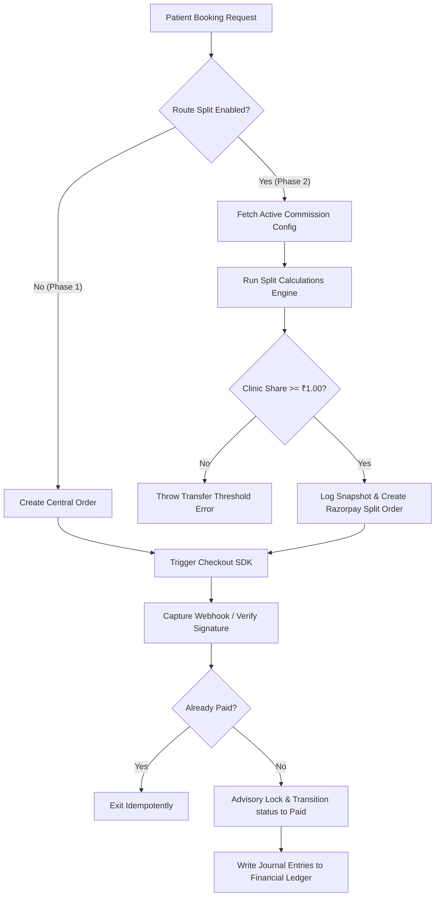
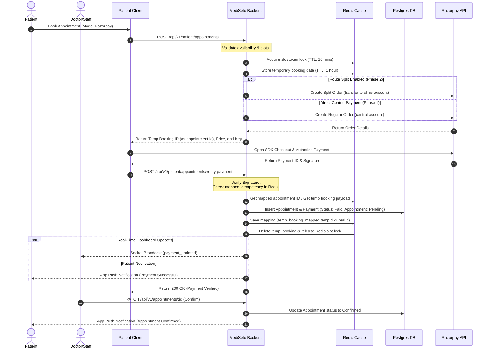
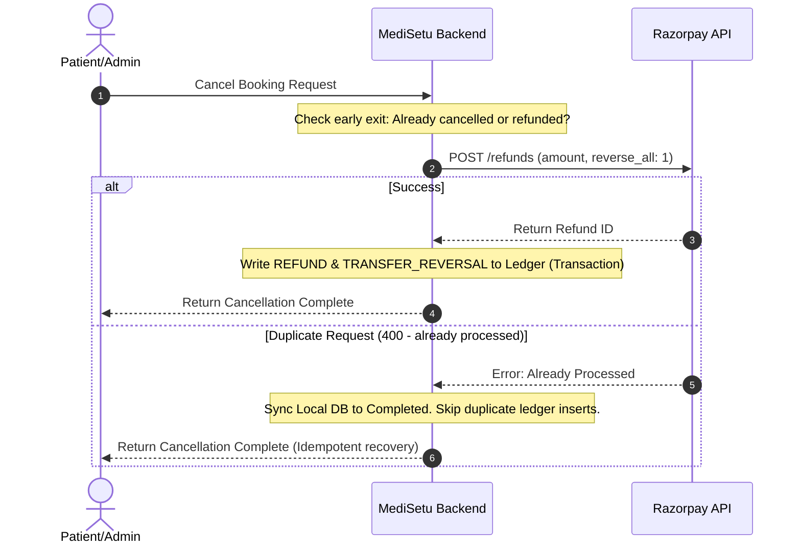
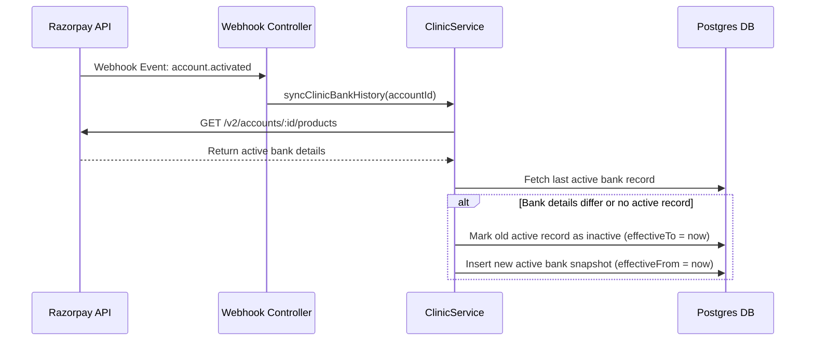
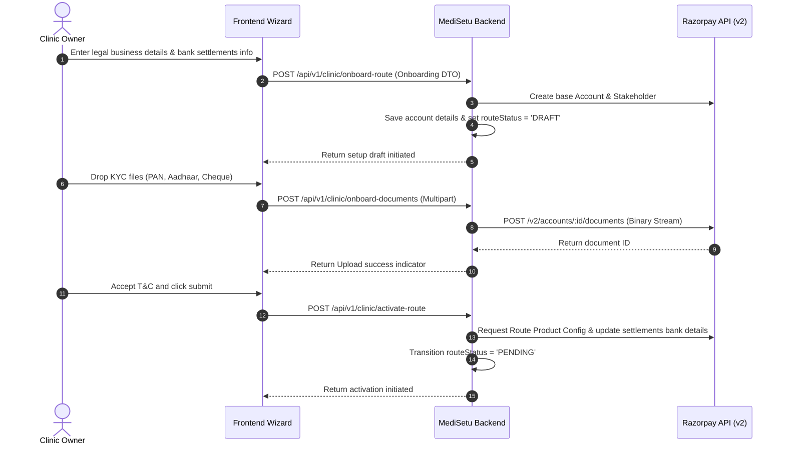

# End-to-End Razorpay Gateway & Commission Split Engine Architecture

This document provides a comprehensive technical reference for the Razorpay Payment Gateway integration, dynamic split payment engine, configuration versioning system, and financial ledgers implemented in the MediSetu backend application.

---

## 1. System Overview

The MediSetu system implements a multi-tenant payment routing system supporting two distinct modes, toggled via the environment variable `ENABLE_RAZORPAY_ROUTE` (configured in [envConfig.ts](file:///d:/MediSetu_backend/src/utils/envConfig.ts)):

| Mode | `ENABLE_RAZORPAY_ROUTE` | Checkout Price | Route Split Target | Payout Mechanics |
| :--- | :--- | :--- | :--- | :--- |
| **Phase 1 (Centralized)** | `false` | Standard price | Platform central account | Clinic share tracked manually via `SettlementRecordModel` for offline settlement. |
| **Phase 2 (Split Route)** | `true` | Price + Patient Convenience markup (if bearer is patient) | Direct split to clinic sub-account | Dynamic split transfer to clinic sub-account, platform fee retained centrally. |

> [!IMPORTANT]
> When `ENABLE_RAZORPAY_ROUTE=true`, the clinic **must** have completed Razorpay onboarding and have `routeStatus` as `'ACTIVE'` inside [ClinicRazorpayAccountModel](file:///d:/MediSetu_backend/src/main/clinic/models/clinicRazorpayAccount.model.ts). If they are not active on Route, the checkout initialization fails.
> When `ENABLE_RAZORPAY_ROUTE=false`, bookings can proceed for any clinic without requiring Route setup.

### Core Objectives
1. **Dynamic Split Calculations:** Automatically handle platform commission, commission GST, and PG processing fee sharing depending on who bears the fee (platform, clinic, or patient).
2. **Immutable Snapshots:** Maintain complete audit fidelity. Once an order is created, the commission configuration at that exact point in time is snapshotted inside the payment record.
3. **Historical Configuration Versioning:** Track commission adjustments using Slowly Changing Dimension (SCD) Type 2 versioning rather than in-place database modifications.
4. **Historical Bank Account Versioning:** Preserve a permanent audit trail of clinic payout bank configurations using SCD Type 2 tracking, ensuring independence from Razorpay's data retention limits.
5. **Append-Only Financial Ledger:** Implement a ledger table logging every monetary event (payment capture, commissions, tax deductions, PG fees, refunds, and clawbacks).
6. **Strict Idempotency:** Webhooks, client retries, and cancellation calls must never trigger duplicate entries, database states, or multiple API executions.

---

## 2. High-Level Design (HLD)

### HLD System Flow



### PG Fee & Convenience Fee Sharing Matrix

PG Fee is estimated at **2% MDR** plus **18% GST** on the MDR (representing a net factor of **2.36%**). The allocation determines the final checkout price and net clinic payout:

| pgFeeBearer | Checkout Price Charged to Patient | PG Fee deducted from Clinic Share? | Net Clinic Share Formula |
| :--- | :--- | :--- | :--- |
| **patient** | `Price / (1 - 0.0236)` *(Convenience Fee Added)* | No | `Price - Commission - CommissionGST` |
| **clinic** | `Price` | Yes | `Price - Commission - CommissionGST - PGFee` |
| **platform**| `Price` | No | `Price - Commission - CommissionGST` *(Platform absorbs PG Fee)* |

### Estimation Formula

To calculate the exact markup amount when the patient bears the gateway fees (ensuring the clinic and platform receive their exact shares without gateway dilution):

$$\text{Checkout Price} = \frac{\text{Base Price}}{1 - (\text{PG Fee Percentage} \times 1.18)}$$

### Code Example (Split Calculations Engine)

Below is the calculation routine implemented in [calculateSplitDetails](file:///d:/MediSetu_backend/src/main/patient/services/patient.service.ts#L101):

```typescript
function calculateSplitDetails(price: number, config: IFinancialSnapshot) {
  const { commissionType, commissionValue, pgFeeBearer, pgFeePercentage, gstOnCommissionEnabled, gstPercentage } = config;

  // 1. Calculate platform commission
  const platformCommission = commissionType === 'percentage' 
    ? price * (commissionValue / 100) 
    : commissionValue;

  // 2. Calculate platform commission tax (GST)
  const gstAmount = gstOnCommissionEnabled 
    ? platformCommission * (gstPercentage / 100) 
    : 0.0;

  // 3. Estimate Razorpay PG Fee (2% MDR + 18% GST on the fee = 2.36% total factor)
  const pgFeeFactor = (pgFeePercentage * 1.18) / 100;
  let pgFee = 0.0;
  let convenienceFee = 0.0;
  let totalCheckoutPrice = price;

  if (pgFeeBearer === 'patient') {
    totalCheckoutPrice = price / (1 - pgFeeFactor);
    convenienceFee = totalCheckoutPrice - price;
    pgFee = convenienceFee;
  } else {
    pgFee = price * pgFeeFactor;
  }

  // 4. Deduct platform fee, GST and PG Fee (if clinic bears) from Clinic Share
  const clinicBearsPg = pgFeeBearer === 'clinic';
  let clinicShareAmount = price - platformCommission - gstAmount - (clinicBearsPg ? pgFee : 0);

  return {
    platformCommission: parseFloat(platformCommission.toFixed(2)),
    gstAmount: parseFloat(gstAmount.toFixed(2)),
    pgFee: parseFloat(pgFee.toFixed(2)),
    convenienceFee: parseFloat(convenienceFee.toFixed(2)),
    clinicShareAmount: parseFloat(Math.max(0, clinicShareAmount).toFixed(2)),
    totalCheckoutPrice: parseFloat(totalCheckoutPrice.toFixed(2)),
    snapshot: config
  };
}
```

---

## 3. Sequence Diagram (Successful Flow)



---

## 4. End-to-End Lifecycle & Edge Cases

### A. Dynamic Booking Flow (`PatientService.bookPatientAppointment`)
1. **Validation**: The backend verifies doctor/patient activity, clinic availability, and double-booking slot availability.
2. **Redis Slot Locking**: It sets a Redis lock on the selected slot or token to reserve it:
   - **Time-Slot Mode**: `slot_lock:<doctorId>:<YYYY-MM-DD>:<HH:MM_AM/PM>`
   - **Token Mode**: `token_lock:<doctorId>:<YYYY-MM-DD>:<tokenNo>`
   - **TTL**: Configured by `PAYMENT_LOCK_TTL_SECONDS` (default: 10 minutes).
   - If the lock cannot be acquired (already locked/booked), it returns `409 Conflict`.
3. **Order Generation**:
   - Calculates split payment details using base price and commission config.
   - If `ENABLE_RAZORPAY_ROUTE` is `true` and the clinic is onboarded, it calls `createRazorpaySplitOrder()`.
   - If `ENABLE_RAZORPAY_ROUTE` is `false`, it calls `createRazorpayAppointmentOrder()`.
4. **Temporary Booking Payload**: The backend serializes the booking payload along with the calculated `splitDetails` and stores it in Redis under `temp_booking:<tempBookingId>` with a 1-hour TTL.
5. **Response**: Returns the temporary booking ID (as `appointment.id` for compatibility), gateway order ID, and payment details to the client. 
   - **No database records are created at this phase.**
   - If order creation fails, the backend immediately releases the Redis slot lock.

### B. Idempotent Payment Verification (`PatientService.confirmPaymentAndAppoint`)
1. **Idempotency Check**: The backend queries `temp_booking_mapped:${appointmentId}` in Redis. If it exists, the payment has already been successfully processed and confirmed; the backend returns early with success.
2. **Retrieve Temp Booking**: The backend retrieves the temporary booking details from `temp_booking:${appointmentId}`.
3. **Database Insertion (Paid status)**:
   - If present, it creates the appointment and payment record in Postgres with `paymentStatus: 'Paid'` and `appointmentStatus: 'Pending'`.
   - Saves the mapping `temp_booking_mapped:${appointmentId} -> realAppointmentId` (TTL: 1 hour) in Redis.
   - Deletes the temporary booking payload and releases the Redis slot lock.
   - Writes journal entries to the `FinancialLedgerModel` inside the transaction.
4. **Late Payment / Expired Checkout Handling**:
   If the temporary checkout has expired (the 10 minutes lock has passed) and the slot has already been booked by another patient:
   - **Postgres Advisory Lock**: Acquires a transaction-level advisory lock `pg_advisory_xact_lock(doctorIdHash, dateHash)` to prevent concurrent conflicts.
   - **Check Conflict**: Verifies if the slot is occupied.
   - **If Slot Occupied**: Creates the appointment as `Cancelled` and the payment record as `Paid` with a refund marker (`refundNotes: 'Refund Required: Slot occupied by another booking'`). Logs activity history, releases the Redis slot lock, writes ledger entries, and returns `409 Conflict`.
   - **If Slot Available**: Creates the appointment as `Pending` and the payment record as `Paid`.
5. **Real-time Event Broadcast**:
   Emits a socket event (`'payment_updated'`) to the clinic's room (`clinic:<id>`) so receptionist and doctor dashboards auto-update without needing page reloads.
6. **In-App Push Notification**:
   Sends an app notification (`notifyPaymentReceived`) to the patient confirming payment receipt.

### C. Refund Clawback Flow (`CancellationPolicyService.processCancellationRequest`)
When an appointment is cancelled, the system handles the refund to the patient and automatically reverses the split transfer back from the clinic's sub-account.



1. **Idempotency Check:** If `appointmentStatus` is already `'Cancelled'` and a completed `CancellationRefund` exists, returns the completed state without making external gateway calls.
2. **Option A Clawback:** Passes `reverse_all: 1` in the Razorpay refund parameters. Razorpay automatically pulls back the clinic's routed transfer relative to the refund amount.
3. **Double Refund Safety:** Catches Razorpay API errors. If the API returns `statusCode = 400` with the message `"Refund already processed"`, the system recovers gracefully, marking local database records as `Completed` without throwing errors or adding duplicate ledger logs.
4. **Ledger Records:** Logs `REFUND` (negative amount representing platform outflow) and `TRANSFER_REVERSAL` (positive amount representing clinic sub-account reversal) atomically.

### D. Webhook-First Payment Finalization (Source of Truth)

> [!IMPORTANT]
> Payment success must always be finalized through Razorpay Webhooks (`payment.captured`, `order.paid`, `refund.processed`). Client-side signature verification should only improve UX and never be treated as the final financial source of truth. Healthcare systems should never rely only on frontend callbacks.

1. **Webhook Handler Endpoint:** The system exposes a raw payload-validated endpoint at `/api/v1/patient/appointments/webhook` mapped to [razorpayAppointmentWebhookController](file:///d:/MediSetu_backend/src/main/patient/controllers/patient.controller.ts#L950).
2. **Signature Verification:** The endpoint verifies webhook payloads out-of-band using signature verification with the configured webhook secret.
3. **Status Syncing:**
   * On `payment.captured`, calls [confirmPaymentAndAppoint](file:///d:/MediSetu_backend/src/main/patient/services/patient.service.ts#L2048) to verify the payment and atomically transition the status, log ledger entries, and clear Redis locks.
   * On `payment.failed`, calls `handlePaymentFailure` to update local databases and release reservation locks.

### E. Clinic/Doctor Confirmation
1. **Status Update**: The backend updates the appointment status:
   - `appointmentStatus`: `'Confirmed'`
2. **Confirmation Notifications**:
   Triggers `notifyAppointmentConfirmed()`, which sends the `'Appointment Confirmed'` push notification to the patient.

---

## 5. Ledger Journal Reference Chart

Below is a reference of ledger entries logged to `FinancialLedgerModel` during various system events.

| Event | Entry Type | Sign | Description |
| :--- | :--- | :--- | :--- |
| **Payment Captured** | `PAYMENT_RECEIVED` | `+` | Patient payment check value captured. |
| **Payment Captured** | `PLATFORM_COMMISSION` | `-` | Platform commission retained. |
| **Payment Captured** | `GST` | `-` | GST on platform commission. |
| **Payment Captured** | `PG_FEE` | `-` | Payment gateway fees. |
| **Payment Captured** | `CONVENIENCE_FEE` | `+` | PG Fee convenience fee markups charged to patient. |
| **Payment Captured** | `TRANSFER_CREATED` | `-` | Split transfer routed to clinic sub-account. |
| **Booking Refunded** | `REFUND` | `-` | Patient refund amount issued. |
| **Booking Refunded** | `TRANSFER_REVERSAL` | `+` | Clinic sub-account clawback returned. |

---

## 6. Historical Bank Account Versioning (SCD Type 2)

To ensure the platform remains fully audit-compliant and never depends solely on external gateways for historical bank information, we implement **Slowly Changing Dimension (SCD Type 2)** tracking for all Route Linked Accounts.

### Architecture & Webhook Synchronization Flow



### Steps of the Sync Operation
1. **Change Initiated:** Bank credentials (IFSC, account number, beneficiary name) are updated on the Razorpay Dashboard (Method A) or via the product configurations API.
2. **Webhook Event (`account.activated`):** Once verified and activated, Razorpay fires the webhook to the backend webhook controller.
3. **Trigger Sync:** The handler fetches the current active product details from the `GET /v2/accounts/:account_id/products` endpoint.
4. **Insert and Snapshot:** 
   * If a change is detected compared to the local active snapshot (`is_active = true`), the system sets `is_active = false` and `effective_to = current_timestamp` on the old database record.
   * A new row is inserted in `ClinicBankHistoryModel` with `is_active = true` and `effective_from = current_timestamp`.

### Audit, Finance, & Tax Compliance Mapping
For statutory audits, finance inspections, and settlement verifications, the target bank account can be queried using the date range of the payout/settlement transaction:
```sql
SELECT bank_name, beneficiary_name, masked_account_number, ifsc_code
FROM clinic_bank_history
WHERE clinic_id = :clinicId
  AND :transactionTimestamp BETWEEN effective_from AND COALESCE(effective_to, NOW());
```
This ensures absolute data independence and verification records matching every transaction version.

### API Endpoint: Retrieving Active Bank Details
To retrieve the clinic's currently active, verified bank account configuration snapshot (used for verification during onboarding/update checks), client applications can call the following endpoint:

* **Endpoint:** `GET /api/v1/clinic/bank-details` (defined in [clinic.route.ts](file:///D:/MediSetu_backend/src/main/clinic/routes/v1/clinic.route.ts))
* **Controller:** [getClinicBankDetailsController](file:///D:/MediSetu_backend/src/main/clinic/controllers/clinic.controller.ts)
* **Service Method:** [ClinicService.getActiveBankDetails](file:///D:/MediSetu_backend/src/main/clinic/services/clinic.service.ts)
* **Access Control:** Requires `requireAuth`, `requireClinic`, and `enforceClinicAutoLogout`.
* **Behavior:** Returns the active database snapshot matching the clinic ID. Returns `null` if no active bank history version is currently found.

#### Response Example
```json
{
  "success": true,
  "message": "Active bank details retrieved successfully",
  "data": {
    "beneficiaryName": "Acme Clinic Pvt Ltd",
    "bankName": "HDFC Bank",
    "maskedAccountNumber": "******1234",
    "ifscCode": "HDFC0000123",
    "isActive": true
  }
}
```

---

## 7. Custom Native Onboarding & Webhook Synchronization Flow

Rather than emailing sub-merchants a hosted registration link, MediSetu exposes a custom native onboarding workflow embedded directly inside the clinic settings panel.

### Database Segregation

All onboarding states, credentials, drafts, and verification remarks are maintained in the dedicated [ClinicRazorpayAccountModel](file:///d:/MediSetu_backend/src/main/clinic/models/clinicRazorpayAccount.model.ts) (`clinic_razorpay_accounts` table), completely decoupled from the core clinic profile details (`clinics` table).

### Onboarding Steps Sequence



### Onboarding Webhook Callback Synchronizer

KYC compliance checks and payout configurations are verified asynchronously by Razorpay. The system registers webhook listeners to process account updates:

1. **`account.activated`**:
   * Transitions local `routeStatus` to `'ACTIVE'` in `clinic_razorpay_accounts`.
   * Triggers active bank settlement configuration retrieval and snapshots it to `ClinicBankHistoryModel`.
2. **`account.updated`**:
   * If status changes to `needs_clarification`, transitions `routeStatus` to `'NEEDS_CLARIFICATION'`.
     Loops through `payload.account.entity.requirements`, extracts the failed validation reasons, and joins them into a semicolon-separated string inside `routeOnboardingRejectionReason` (e.g. *"PAN card name mismatch; Cheque copy blurred"*). This warning is surfaced on the clinic dashboard.
   * If status changes to `suspended`, transitions `routeStatus` to `'SUSPENDED'`, immediately freezing online checkouts for that clinic on the platform.
   * If status changes to `activated`, transitions `routeStatus` to `'ACTIVE'` and triggers active bank history sync.
3. **`product.activated`**:
   * If the product name is `'route'`, transitions `routeStatus` to `'ACTIVE'` and triggers active bank history sync.
