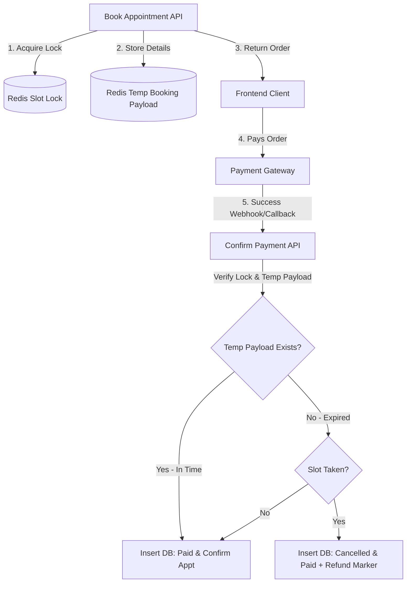

# Redis Slot Locking & Payment Reservation Flow (Redis-Only Checkout)

This document details the architecture, design, and step-by-step sequence of the Redis-backed slot reservation and temporary checkout mechanism.

---

## 1. Overview & Objective
When booking online appointments via online gateways (e.g., Razorpay), we utilize a **Redis-only temporary checkout reservation** pattern rather than writing pending state to the database:
1. **Prevent Double Booking**: Reserve a slot/token for **10 minutes** (configurable via `PAYMENT_LOCK_TTL_SECONDS`) using Redis locks.
2. **Purely In-Memory Booking State**: Booking details are stored temporarily in Redis during checkout, completely eliminating unfinished/abandoned pending checkouts from cluttering the Postgres database.
3. **Passive Expiry & Cleanup**: Slots and temporary payloads automatically expire via Redis TTL, removing the need for active background cleanup queues (like BullMQ) for unpaid checkouts.
4. **Post-expiry/Late Payments Graceful Conflict Resolution**: If a user pays after the 10-minute lock window and the slot is already occupied, we record the payment as `Paid` (with a `Cancelled` appointment and `Refund Required` notes) to maintain accounting integrity, throwing a `409 Conflict` error.

---

## 2. Key Components & Architecture

### Redis Lock Keys
Locks are stored in Redis with the following patterns depending on the clinic scheduling mode:
* **Time-Slot Mode**: `slot_lock:<doctorId>:<YYYY-MM-DD>:<HH:MM_AM/PM>`
* **Token Mode**: `token_lock:<doctorId>:<YYYY-MM-DD>:<tokenNo>`
* Lock TTL is set to configurable `PAYMENT_LOCK_TTL_SECONDS` (default: 10 minutes).

### Temporary Booking Payload
* **Pattern**: `temp_booking:<tempBookingId>`
* Stores the serialized payload needed to create the appointment, the auto-assigned/assigned token number, duration, and billing gateway order details.
* Saved in Redis with a TTL of 1 hour to allow webhook processing window.

### Postgres Advisory Locks (Late Checkout Race Prevention)
* To prevent race conditions during concurrent checkouts, we acquire transaction-level advisory locks using `pg_advisory_xact_lock(key1, key2)` where:
  * `key1` = Hash of `doctorId`
  * `key2` = Hash of `date` (YYYY-MM-DD)
* This ensures that only one payment confirmation transaction for the same doctor and date can run at a time.

---

## 3. Detailed API Flow

### Phase 1: Creating a Checkout & Lock (Booking Endpoint)
1. **Validate Slot**: Check slot/token availability against active bookings in Postgres and active locks in Redis.
2. **Lock Slot**: Attempt to set the Redis lock key with `NX` (set if not exists) and a `PX` (TTL) of 10 minutes.
   * If the key exists, return `409 Conflict` ("This slot is already reserved").
3. **Gateway Order**: Generate the Razorpay split or regular order.
4. **Save Temporary Booking**: Save details under `temp_booking:${tempBookingId}` in Redis with a 1-hour TTL.
5. **Return Order Details**: Return the temporary booking ID (as `appointment.id` to maintain frontend compatibility), gateway order ID, and payment details.
   * **No database records are created at this phase.**

### Phase 2: Gateway Callback & Confirmation
1. **Advisory Lock**: Acquire a Postgres transaction-level advisory lock on the doctor + date.
2. **Idempotency Check**: Check if the transaction was already processed by querying `temp_booking_mapped:${appointmentId}`. If it exists, return early (`{ success: true, message: 'Already paid' }`).
3. **Retrieve Temp Booking**: Read the payload from `temp_booking:${appointmentId}`.
4. **Process Booking**:
   * **If Temp Booking Exists (Valid Checkout Window)**:
     * Call `AppointmentService.createAppointment` to insert the appointment and payment record in `Paid` status.
     * Save the mapping `temp_booking_mapped:${appointmentId} -> realAppointmentId` in Redis (TTL: 1 hour).
     * Delete the temporary booking payload and release the Redis slot lock.
   * **If Temp Booking Missing (Expired Checkout/Late Payment)**:
     * Query slot availability to check for conflicts (e.g. if another user has since booked the slot/token).
     * **If Conflict**:
       * Create the appointment with `appointmentStatus = 'Cancelled'` and the payment record with `paymentStatus = 'Paid'` and `refundNotes = 'Refund Required'`.
       * Log late payment conflict history, broadcast changes, and throw a `409 Conflict`.
     * **If No Conflict**:
       * Create the appointment as `Pending` and payment as `Paid`.
       * Commit and return success.

### Phase 3: Passive Cleanup
* No active background workers (BullMQ) are required for unpaid bookings.
* If a patient abandons checkout, the Redis slot lock expires naturally after 10 minutes (restoring slot availability), and the temporary booking details expire after 1 hour.

---

## 4. Detailed End-to-End Flow & State Transitions

The following table summarizes the system state, Redis lock state, and visibility across different booking phases and scenarios:

| Phase / Scenario | Postgres Appointment Status | Postgres Payment Status | Postgres Refund Notes | Redis Lock State | BullMQ Reminder Queue | Visible to Doctor / Patient Lists | Slot Availability |
| :--- | :--- | :--- | :--- | :--- | :--- | :--- | :--- |
| **1. Checkout Initiated** | `'Pending'` | `'Pending'` | `null` | Active (Configurable TTL) | Scheduled | **No** (Hidden via SQL helper) | **Reserved** (Blocked) |
| **2A. Payment Successful (within TTL)** | `'Pending'` (keeps same) | `'Paid'` | `null` | Deleted | Retained | **Yes** (Visible) | **Booked** (Blocked permanently) |
| **2B. Payment Abandoned (after TTL)** | `'Cancelled'` (via BullMQ worker) | `'Failed'` (via BullMQ worker) | `null` | Expired (Deleted) | Cleared / Removed | **No** (Shows as Cancelled) | **Available** (Free to book) |
| **2C. Late Payment (after TTL) - Slot Free** | `'Pending'` (confirmed) | `'Paid'` | `null` | Expired (Deleted) | Retained | **Yes** (Visible) | **Booked** (Blocked permanently) |
| **2D. Late Payment (after TTL) - Slot Taken** | `'Cancelled'` (remains Cancelled) | `'Paid'` (Accounting-clean) | `'Refund Required: Slot occupied by another booking'` | Expired (Deleted) | Cleared / Removed | **No** (Omitted from active lists) | **Booked** (By the other user) |

---

## 5. Slot Availability & Filter Logic

Availability checks remain purely read-only to support high scalability.

### Availability Query
1. Queries all active appointments (status not `Cancelled`) for the target doctor and date from Postgres.
2. Groups all keys needed for active lock verification.
3. Uses a Redis **pipeline** (`exists` commands in a single roundtrip) to fetch lock statuses for all slots/tokens concurrently.
4. Filters out any slots/tokens that have active Redis locks, returning only truly available slots.
