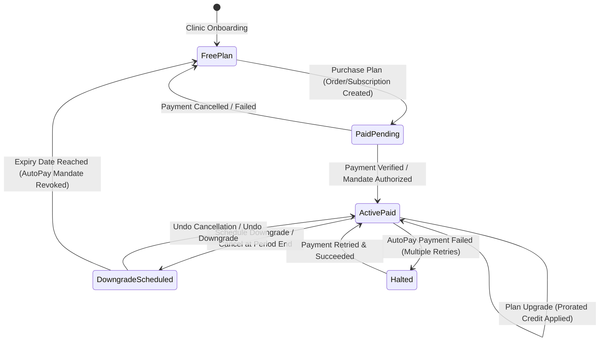
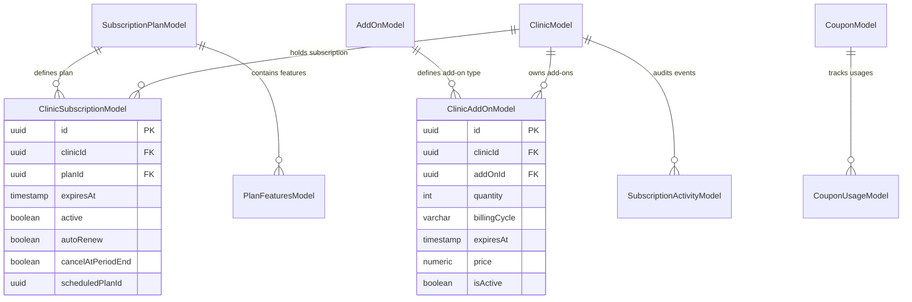
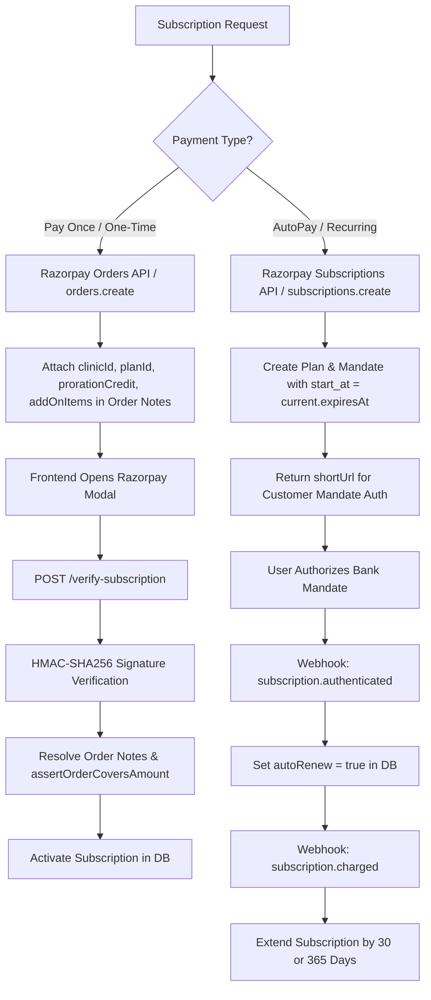
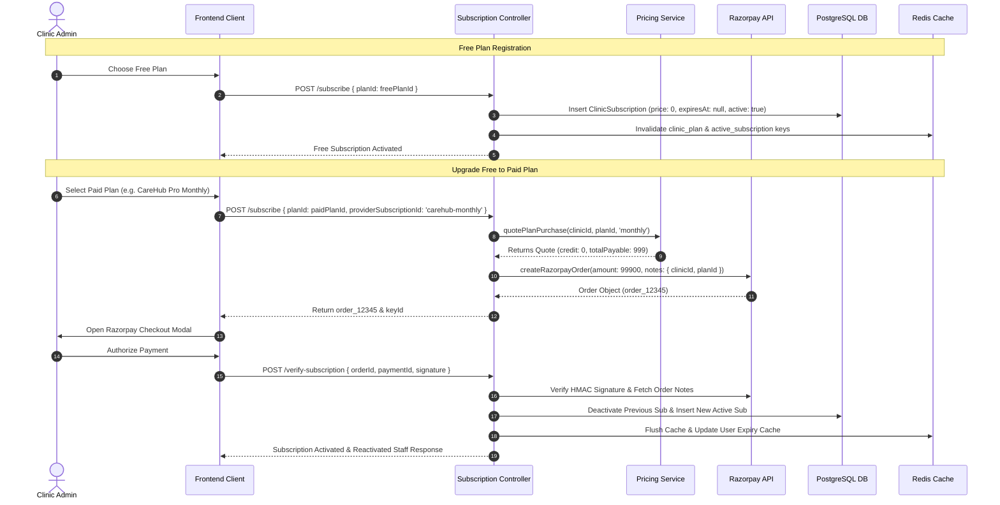
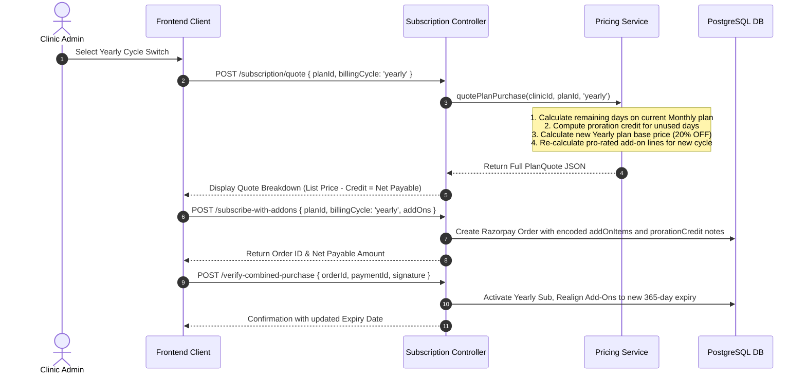
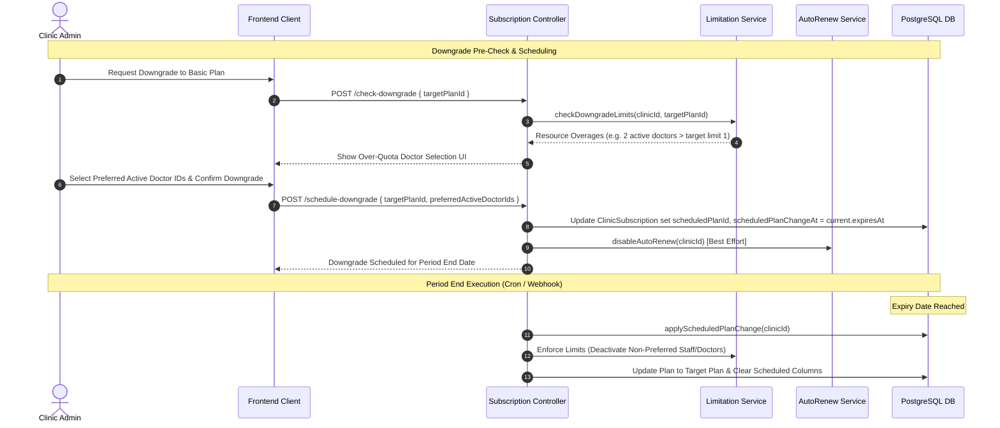
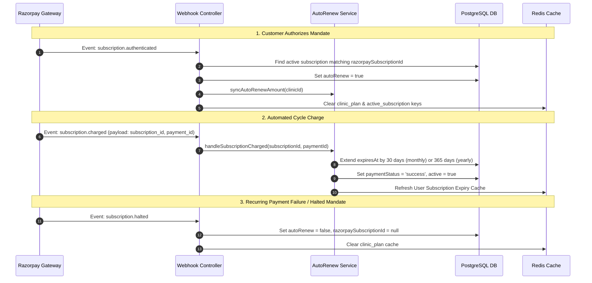

# Subscription & Add-Ons Architecture (HLD & LLD Document)

## Document Overview
This document provides a comprehensive High-Level Design (HLD) and Low-Level Design (LLD) for the **MediSetu Backend Subscription System**. It details the complete subscription life-cycle, add-ons management, proration credit engine, Razorpay AutoPay (Recurring Mandates) vs Pay Once (One-Time Orders) flows, database schema specifications, and missing parameter mappings.

---

# Table of Contents
1. [High-Level Design (HLD)](#1-high-level-design-hld)
   - [System Context & Architecture](#system-context--architecture)
   - [Core Components](#core-components)
   - [Subscription & Add-Ons Lifecycle State Machine](#subscription--add-ons-lifecycle-state-machine)
2. [Low-Level Design (LLD)](#2-low-level-design-lld)
   - [Database Data Models & Entity Relations](#database-data-models--entity-relations)
   - [API Endpoints & Request/Response Signatures](#api-endpoints--requestresponse-signatures)
   - [Proration Pricing Credit Engine](#proration-pricing-credit-engine)
   - [Razorpay Integration: AutoPay vs Pay Once](#razorpay-integration-autopay-vs-pay-once)
3. [Detailed End-to-End Workflows](#3-detailed-end-to-end-workflows)
   - [Flow 1: Free Plan Activation & Free to Paid Upgrade](#flow-1-free-plan-activation--free-to-paid-upgrade)
   - [Flow 2: Paid Plan Upgrade & Billing Cycle Switch (Monthly to Yearly)](#flow-2-paid-plan-upgrade--billing-cycle-switch-monthly-to-yearly)
   - [Flow 3: Plan Downgrade & Scheduled Cancellation](#flow-3-plan-downgrade--scheduled-cancellation)
   - [Flow 4: Add-On Purchase & Re-alignment](#flow-4-add-on-purchase--re-alignment)
   - [Flow 5: Razorpay AutoPay Mandate Authorization & Auto-Renew Webhooks](#flow-5-razorpay-autopay-mandate-authorization--auto-renew-webhooks)
4. [Parameters & Redis Cache Keys Matrix](#4-parameters--redis-cache-keys-matrix)

---

# 1. High-Level Design (HLD)

## System Context & Architecture

The MediSetu Subscription System governs clinic tier access, feature limitations (doctor/staff accounts, cloud storage, branches), add-on provisioning, proration credit calculations, and automated renewal via Razorpay.

```mermaid
graph TD
    Client[Client App / Web Dashboard] --> API Gateway / Express Router
    API Gateway / Express Router --> SubCtrl[Subscription Controller]
    API Gateway / Express Router --> AddOnCtrl[Add-On Controller]
    API Gateway / Express Router --> CombinedCtrl[Combined Purchase Controller]
    API Gateway / Express Router --> WebhookCtrl[Razorpay Webhook Controller]

    SubCtrl --> SubSvc[Subscription Service]
    SubCtrl --> PricingSvc[Pricing Service]
    AddOnCtrl --> AddOnSvc[Add-On Service]
    CombinedCtrl --> PricingSvc
    WebhookCtrl --> AutoRenewSvc[AutoRenew Service]
    WebhookCtrl --> SubSvc

    SubSvc --> LimitSvc[Limitation Service]
    AutoRenewSvc --> RazorpayAPI[Razorpay Gateway API]
    PricingSvc --> CouponSvc[Coupon Service]

    SubSvc --> DB[(PostgreSQL Database)]
    AutoRenewSvc --> Redis[(Redis Cache)]
    LimitSvc --> Redis
```

## Core Components

| Component | Layer | Primary Responsibility |
| :--- | :--- | :--- |
| `SubscriptionController` | Controller | Handles HTTP routes for subscribing, changing cycles, downgrading, cancelling, and verifying payments. |
| `CombinedPurchaseController` | Controller | Single endpoint (`/subscribe-with-addons`) for simultaneous plan and add-on purchase with single order generation. |
| `PricingService` | Service | Single source of truth for pricing quotes, proration credit calculations, add-on line item proration, and coupon adjustments. |
| `SubscriptionService` | Service | Manages DB records for clinic subscriptions, state updates, activity logging, and cache invalidation. |
| `AddOnService` | Service | Manages add-on catalogue, max cap enforcement (doctors, staff, storage), pro-rated add-on quotes, and add-on activations. |
| `AutoRenewService` | Service | Handles Razorpay Recurring Subscriptions API, mandate creation, recurring amount synchronization (base + active add-ons), and `subscription.charged` webhooks. |
| `LimitationService` | Service | Computes total resource capacities (plan limits + active add-ons) and enforces downgrades/staff reactivations. |
| `razorpayOrder.utils` | Utility | Handles Razorpay order creation, note encoding/decoding, HMAC signature verification, and `assertOrderCoversAmount` security validation. |
| `billingCycle.utils` | Utility | Provides single-source-of-truth formulas for yearly discounts (20%), billing cycle days (30 vs 365 days), and unused subscription value. |

## Subscription & Add-Ons Lifecycle State Machine



---

# 2. Low-Level Design (LLD)

## Database Data Models & Entity Relations

### 1. `SubscriptionPlanModel` (`subscription_plans`)
Defines base tier pricing and trial rules.
- `id` (UUID, Primary Key)
- `slug` (Varchar, Unique) - e.g., `'solo'`, `'carehub-basic'`, `'carehub-pro'`
- `name` (Varchar)
- `description` (Text)
- `price` (Numeric(10, 2)) - Base monthly list price in INR.
- `currency` (Varchar) - Default `'INR'`
- `trialDays` (Integer) - Default `15`

### 2. `ClinicSubscriptionModel` (`clinic_subscriptions`)
Represents a clinic's active or historical subscription state.
- `id` (UUID, Primary Key)
- `clinicId` (UUID, Foreign Key -> `clinics.id`)
- `planId` (UUID, Foreign Key -> `subscription_plans.id`)
- `startsAt` (Timestamp)
- `expiresAt` (Timestamp, Nullable for Free plan)
- `active` (Boolean) - Default `true`
- `provider` (Varchar) - `'razorpay'`, `'manual'`, `'coupon'`, `'credit'`
- `providerSubscriptionId` (Varchar) - Cycle marker (e.g. `'carehub-monthly'`, `'carehub-yearly'`, `'free_plan'`)
- `razorpaySubscriptionId` (Varchar, Nullable) - Mandate ID starting with `sub_`
- `paymentMode` (Varchar) - `'online'`, `'card'`, `'upi'`, `'free'`, `'coupon'`, `'credit'`
- `transactionId` (Varchar) - Payment ID or Order ID starting with `pay_`
- `paymentStatus` (Varchar) - `'success'`, `'pending'`, `'failed'`
- `price` (Numeric(10, 2)) - Actual net price charged after proration and coupons
- `discount` (Numeric(10, 2)) - Applied coupon or credit discount amount
- `autoRenew` (Boolean) - Default `false` (turns `true` upon mandate authorization)
- `cancelAtPeriodEnd` (Boolean) - Default `false`
- `cancelledAt` (Timestamp, Nullable)
- `cancellationReason` (Text, Nullable)
- `scheduledPlanId` (UUID, Nullable) - Target plan for period-end downgrade
- `scheduledPlanChangeAt` (Timestamp, Nullable)
- `scheduledProviderSubscriptionId` (Varchar, Nullable)

### 3. `AddOnModel` (`add_ons`)
Master catalogue for purchaseable capacity extensions.
- `id` (UUID, Primary Key)
- `name` (Varchar) - e.g., `'Additional Doctor Account'`
- `description` (Text)
- `featureKey` (Varchar) - `'additional_doctor'`, `'additional_staff'`, `'additional_storage'`, `'additional_branch'`
- `unitValue` (Integer) - Incremental capacity provided per unit (e.g. `1` doctor, `1024` MB storage)
- `monthlyPrice` (Numeric(10, 2)) - Base monthly unit price
- `yearlyPrice` (Numeric(10, 2)) - Base yearly unit price (discounted)
- `currency` (Varchar) - Default `'INR'`
- `maxCap` (Integer, Nullable) - Maximum total capacity allowed (e.g. `9` doctors, `20` staff, `5120` MB storage)
- `isActive` (Boolean) - Default `true`

### 4. `ClinicAddOnModel` (`clinic_add_ons`)
Tracks active add-ons provisioned for a clinic.
- `id` (UUID, Primary Key)
- `clinicId` (UUID, Foreign Key)
- `addOnId` (UUID, Foreign Key -> `add_ons.id`)
- `quantity` (Integer)
- `billingCycle` (Varchar) - `'monthly'` | `'yearly'`
- `startsAt` (Timestamp)
- `expiresAt` (Timestamp) - Aligned to `ClinicSubscriptionModel.expiresAt`
- `price` (Numeric(10, 2)) - Pro-rated price paid for the initial fractional/full period
- `isActive` (Boolean) - Default `true`
- `provider` (Varchar) - `'razorpay'`
- `providerSubscriptionId` (Varchar) - Order ID or Subscription ID
- `paymentStatus` (Varchar) - `'success'`, `'pending'`, `'failed'`
- `paymentMode` (Varchar)
- `transactionId` (Varchar)
- `cancelAtPeriodEnd` (Boolean) - Default `false`
- `cancelledAt` (Timestamp, Nullable)

---

## Database Entity Relationship Diagram (ERD)



---

## API Endpoints & Request/Response Signatures

### 1. `POST /api/v1/subscription/quote`
Computes complete quote preview without creating a Razorpay order.

**Request Body:**
```json
{
  "planId": "b1a2c3d4-e5f6-7890-abcd-1234567890ab",
  "billingCycle": "yearly",
  "couponCode": "SAVE20"
}
```

**Response Body:**
```json
{
  "status": "success",
  "message": "Plan quote",
  "data": {
    "plan": {
      "id": "b1a2c3d4-e5f6-7890-abcd-1234567890ab",
      "name": "CareHub Pro",
      "slug": "carehub-pro",
      "billingCycle": "yearly"
    },
    "currency": "INR",
    "basePrice": 9590,
    "yearlySavings": 2398,
    "prorationCredit": 450,
    "prorationDays": 15,
    "addOns": [
      {
        "clinicAddOnId": "a1b2c3-addon-id",
        "addOnId": "addOn-uuid",
        "name": "Additional Doctor Account",
        "quantity": 1,
        "newCyclePrice": 4790,
        "credit": 200,
        "payable": 4590
      }
    ],
    "addOnTotal": 4590,
    "addOnCredit": 200,
    "couponCode": "SAVE20",
    "couponId": 12,
    "couponDiscount": 914,
    "subtotal": 13730,
    "totalPayable": 12816,
    "expiresAt": "2027-09-24T17:36:22.000Z",
    "isCycleChange": false,
    "currentSubscription": {
      "planName": "CareHub Basic",
      "billingCycle": "monthly",
      "expiresAt": "2026-10-09T17:36:22.000Z"
    }
  }
}
```

### 2. `POST /api/v1/subscription/subscribe`
Creates a Razorpay order or direct activation for a plan.

**Request Body:**
```json
{
  "planId": "b1a2c3d4-e5f6-7890-abcd-1234567890ab",
  "providerSubscriptionId": "carehub-yearly",
  "couponCode": "SAVE20"
}
```

### 3. `POST /api/v1/subscription/subscribe-with-addons`
Combined one-step order creation for subscription + add-ons.

**Request Body:**
```json
{
  "planId": "b1a2c3d4-e5f6-7890-abcd-1234567890ab",
  "billingCycle": "yearly",
  "addOns": [
    { "addOnId": "addon-uuid-1", "quantity": 2 }
  ]
}
```

### 4. `POST /api/v1/subscription/verify-subscription` / `verify-combined-purchase`
Verifies Razorpay payment signature and activates plan + realigns add-ons.

**Request Body:**
```json
{
  "orderId": "order_P1Q2R3S4T5",
  "paymentId": "pay_X9Y8Z7W6V5",
  "signature": "e3b0c44298fc1c149afbf4c8996fb92427ae41e4649b934ca495991b7852b855"
}
```

---

## Proration Pricing Credit Engine

### Unused Subscription Value Formula
When a clinic switches or upgrades plans mid-cycle, the remaining value of the current active plan is calculated day-by-day and credited against the new total:

$$\text{msPerDay} = 86,400,000\text{ ms}$$

$$\text{totalDays} = \max\left(0, \left\lceil \frac{\text{expiresAt} - \text{startsAt}}{\text{msPerDay}} \right\rceil\right)$$

$$\text{remainingDays} = \max\left(0, \left\lceil \frac{\text{expiresAt} - \text{now}}{\text{msPerDay}} \right\rceil\right)$$

$$\text{usableDays} = \min(\text{remainingDays}, \text{totalDays})$$

$$\text{credit} = \min\left(\text{pricePaid}, \text{Round}\left( \frac{\text{pricePaid}}{\text{totalDays}} \times \text{usableDays} \right)\right)$$

### Net Quote Pricing Formula
$$\text{basePrice} = \begin{cases} \text{Round}(\text{monthlyPrice} \times 12 \times 0.8) & \text{if } \text{cycle} = \text{'yearly'} \\ \text{monthlyPrice} & \text{if } \text{cycle} = \text{'monthly'} \end{cases}$$

$$\text{prorationCredit} = \min(\text{credit}, \text{basePrice})$$

$$\text{subtotal} = \max(0, \text{basePrice} - \text{prorationCredit}) + \text{addOnTotal}$$

$$\text{totalPayable} = \max(0, \text{subtotal} - \text{couponDiscount})$$

> **Safety Rule:** Credit can never exceed the purchase price or result in a negative total. If `totalPayable <= 0` (e.g. 100% coupon or full credit), the subscription is activated directly without creating a Razorpay order (`provider = 'credit' | 'coupon'`).

---

## Razorpay Integration: AutoPay vs Pay Once



### AutoPay (Recurring Mandate) Rules:
1. **Recurring Amount Calculation:**
   $$\text{Recurring Amount (paise)} = \text{Round}\big((\text{Plan Price for Cycle} + \text{Active Add-Ons Recurring Total}) \times 100\big)$$
2. **Delayed Charge Start:** `start_at` parameter passed to Razorpay is set to `expiresAt` of current subscription so the user is NOT double charged on day 1.
3. **Mandate Authorization Verification:** Initial state sets `autoRenew = false`. Only when Razorpay emits `subscription.authenticated` webhook does `autoRenew` flip to `true`.

---

# 3. Detailed End-to-End Workflows

## Flow 1: Free Plan Activation & Free to Paid Upgrade



---

## Flow 2: Paid Plan Upgrade & Billing Cycle Switch (Monthly to Yearly)



---

## Flow 3: Plan Downgrade & Scheduled Cancellation



---

## Flow 4: Add-On Purchase & Re-alignment

### Add-On Pro-Rata Pricing Formula:
$$\text{remainingDays} = \max\left(1, \left\lceil \frac{\text{subscriptionExpiresAt} - \text{now}}{86,400,000} \right\rceil\right)$$

$$\text{proRatedUnitPrice} = \text{Round}\left( \frac{\text{planPriceForCycle}(\text{unitPrice}, \text{cycle})}{\text{CYCLE\_DAYS}[\text{cycle}]} \times \text{remainingDays} \right)$$

$$\text{proRatedTotalPrice} = \text{proRatedUnitPrice} \times \text{quantity}$$

### Re-alignment Rule (`PricingService.realignAddOnsToPeriod`):
When the parent subscription's period changes (e.g., Monthly to Yearly upgrade), active add-ons are updated to match the new `expiresAt` date and `billingCycle`, charging the quoted net difference so add-ons never expire early while the main plan is still paid for.

---

## Flow 5: Razorpay AutoPay Mandate Authorization & Auto-Renew Webhooks



---

# 4. Parameters & Redis Cache Keys Matrix

## 1. Razorpay Order Notes Metadata Structure
Passed in Razorpay `orders.create` notes to ensure tamper-proof payload resolution on `/verify-subscription`:

| Parameter Key | Data Type | Description |
| :--- | :--- | :--- |
| `clinicId` | UUID String | Clinic owning the purchase (validated against `req.clinicId`). |
| `planId` | UUID String | Target subscription plan ID. |
| `providerSubscriptionId` | String | Billing cycle provider ID (`'carehub-monthly'`, `'carehub-yearly'`). |
| `prorationCredit` | Numeric String | Credit applied for unused days of previous plan (in Rupees). |
| `addOnItems` | Encoded String | Format: `addOnId:quantity:m\|y,addOnId:quantity:m\|y` |
| `couponId` | Numeric String | ID of applied coupon. |
| `couponCode` | String | Coupon code string. |
| `originalAmount` | Numeric String | List price before coupon discount. |
| `discountAmount` | Numeric String | Coupon discount value. |
| `initialAmount` | Numeric String | Initial payment amount captured for recurring mandate setups. |

## 2. Redis Cache Keys Directory

| Cache Key Pattern | TTL | Usage / Purpose |
| :--- | :--- | :--- |
| `clinic_active_subscription:<clinicId>` | Variable / Event-based | Caches active subscription object for middleware checks. |
| `clinic_plan:<clinicId>` | Variable | Caches clinic plan details and permissions. |
| `pending_autopay_subscription:<clinicId>` | Short-lived | Self-healing check for initial AutoPay authorization reconciliation. |
| `user_subscription_expiry:<userId>` | Expiry TTL / 24h | User level JWT/Auth token expiration verification. |
| `scheduled_downgrade_preferences:<clinicId>` | Until scheduled execution | Stores user-selected active doctor/staff IDs for downgrade enforcement. |
| `clinic_limits:<clinicId>` | 5 minutes | Caches calculated limits overview (doctors, staff, storage). |
| `addons:active` | 5 minutes | Caches active add-on catalogue items. |

---

# Summary & Conformance Checklist
- ✅ **Free to Paid & Monthly to Yearly Upgrade Flow** fully documented with sequence diagrams and mathematical formulas.
- ✅ **Proration Credit Calculation Engine** detailed with daily-rate logic and capping constraints.
- ✅ **Razorpay AutoPay (Subscriptions API) vs Pay Once (Orders API)** step-by-step breakdown.
- ✅ **High Level Design (HLD) & Low Level Design (LLD)** with complete database schema, ERD, and state machine diagrams.
- ✅ **Missing parameters and Redis cache mapping** enumerated in reference tables.
