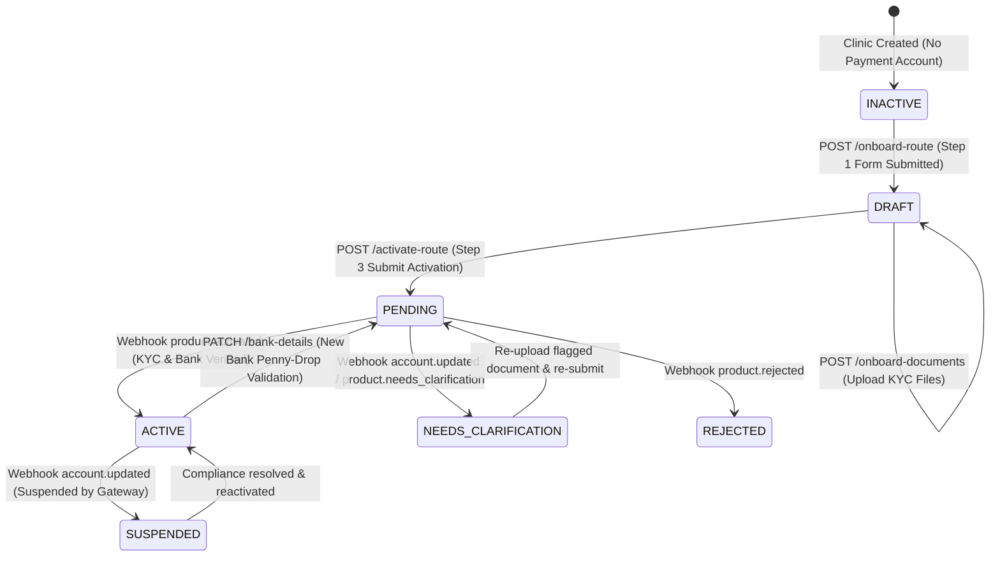
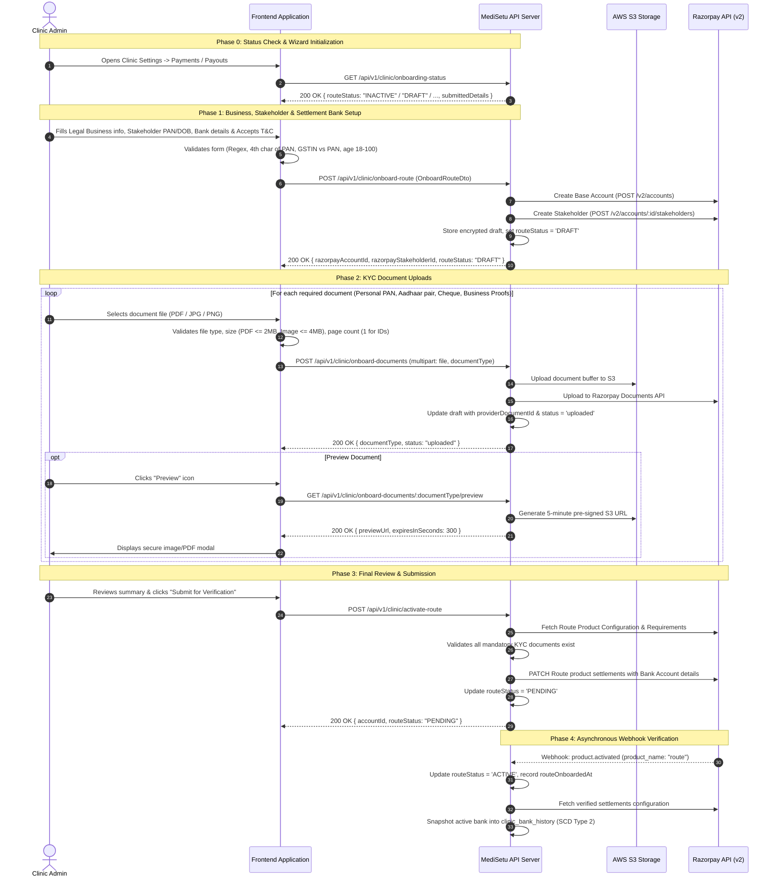

# Clinic Linked Account (Razorpay Route) & Document Upload: Frontend Integration Guide

**MediSetu Healthcare Platform**  
*Target Audience: Frontend Web & Mobile Developers*  
*Integration Target: Razorpay Route Linked Accounts (Custom Native Sub-Merchant Onboarding)*  
*Backend Version: 2.x / Production Real*  
*Base API Prefix: `/api/v1/clinic`*

---

## 1. Overview & Architecture

MediSetu provides a **custom native sub-merchant onboarding experience** embedded directly inside the clinic settings panel. Instead of redirecting doctors/clinic administrators to a third-party hosted registration URL, the entire lifecycle—legal entity profiling, stakeholder declaration, settlement bank account configuration, KYC document upload, and status tracking—is managed seamlessly within the MediSetu UI.

### 1.1. Core Architectural Principles
1. **Multi-Tenancy & Context**:  
   All onboarding endpoints are scoped to the authenticated user's clinic. The backend automatically resolves `req.clinicId` from the user session (`requireAuth`, `requireClinic`, `requireRole(['Admin', 'Super_Admin'])`). The frontend **does not** need to pass a `clinicId` in path or body params for Route onboarding endpoints.
2. **Encrypted Server-Side Draft Storage**:  
   Onboarding inputs (business name, entity type, stakeholder info, bank accounts, and document upload statuses) are encrypted and persisted in `ClinicPaymentAccountModel.onboardingDraftData`. Sensitive fields (such as PAN, date of birth, and bank account numbers) are masked in status responses.
3. **Distributed Concurrency Lock**:  
   To prevent duplicate Razorpay sub-account creation or conflicting document updates, the backend acquires a distributed Redis lock per clinic (`razorpay_route_onboarding_lock:${clinicId}`, TTL: 300 seconds) on every mutating operation (`onboard-route`, `activate-route`, `onboard-documents`, `retry`). Concurrent requests return `409 Conflict`.
4. **Asynchronous Verification (Webhook-First)**:  
   After the clinic submits documents and bank details, Razorpay executes automated KYC verification and penny-drop bank account validation asynchronously. Webhooks (`account.updated`, `product.activated`, `product.rejected`) update the database in the background.

---

## 2. Onboarding Lifecycle & State Machine

Every clinic payment account transitions through strict lifecycle states stored in `ClinicPaymentAccountModel.routeStatus`:



### State Definitions & Frontend Action Guide

| `routeStatus` | System State Description | Frontend UI Presentation & Permitted Actions |
| :--- | :--- | :--- |
| `INACTIVE` | No Route account exists yet. | Display **"Setup Online Payouts" / "Link Bank Account"** wizard banner. Direct user to **Step 1 Form**. |
| `DRAFT` (with `accountId`) | Base Account & Stakeholder created in Razorpay. Documents or activation pending. | Display onboarding wizard in progress. Enable **Step 2 (Document Upload Center)** and **Step 3 (Review & Activate)**. |
| `DRAFT` (`accountId: null`) | Preliminary form details saved, but Razorpay account creation failed or was interrupted. | Keep user on **Step 1 (Entity & Bank Form)** with pre-filled inputs and show `rejectionReason` warning banner. |
| `PENDING` | Application and bank details submitted to Razorpay. Penny drop / KYC review underway. | Show non-blocking informational banner: *"Verification in Progress (typically 24–48 business hours)"*. Lock Step 1 & Step 2 form fields. |
| `NEEDS_CLARIFICATION` | Razorpay rejected one or more documents or data fields. Detailed remarks available in `rejectionReason`. | Show prominent **Warning Banner** displaying `rejectionReason`. Highlight rejected documents and enable re-upload exclusively for requested files. |
| `ACTIVE` | Account fully verified and activated for split settlements. Active bank snapshot recorded. | Display green **"Verified Settlement Account"** badge, masked active bank details (`GET /bank-details`), and an **"Update Bank Account"** button. |
| `SUSPENDED` | Account suspended by Razorpay compliance. Online checkouts frozen. | Display critical red banner: *"Account Suspended by Payment Gateway. Online checkouts disabled. Please contact MediSetu Support."* |
| `REJECTED` | Application permanently rejected by Razorpay. | Display red alert with `rejectionReason` and contact support CTA. |

---

## 3. End-to-End Sequence Diagram



---

## 4. Complete API Specifications

All endpoints require standard Bearer Authentication:
```http
Authorization: Bearer <USER_JWT_TOKEN>
```
The caller must have role `Admin` or `Super_Admin` and be assigned to an active clinic.

---

### 4.1. `GET /api/v1/clinic/onboarding-status`
Retrieves current Route linked account state, rejection/clarification reasons, and existing draft submission details (with sensitive data masked).

* **Method**: `GET`
* **Path**: `/api/v1/clinic/onboarding-status`
* **Headers**: `Authorization: Bearer <token>`
* **Request Body**: None

#### Success Response (`200 OK`)
```json
{
  "success": true,
  "message": "Onboarding status retrieved successfully",
  "data": {
    "accountId": "acc_PQRST123456789",
    "routeStatus": "DRAFT",
    "rejectionReason": null,
    "submittedDetails": {
      "legalBusinessName": "Apex Healthcare Services LLP",
      "businessType": "llp",
      "businessPan": "******456A",
      "gstin": "27AAACA1234A1Z5",
      "address": {
        "street1": "101 Lotus Business Park",
        "street2": "Linking Road",
        "city": "Mumbai",
        "state": "Maharashtra",
        "postalCode": 400050
      },
      "stakeholder": {
        "name": "Dr. Rajesh Sharma",
        "email": "dr.sharma@apexhealth.in",
        "phone": "9876543210",
        "pan": "******789B",
        "relationship": {
          "director": false,
          "executive": true
        },
        "percentageOwnership": 51.5
      },
      "bankDetails": {
        "beneficiaryName": "Apex Healthcare Services LLP",
        "accountNumber": "******8901",
        "ifscCode": "HDFC0000123",
        "accountType": "current"
      },
      "tncAccepted": true
    },
    "uploadedDocuments": [
      {
        "documentType": "personal_pan",
        "fileName": "pan_dr_sharma.jpg",
        "status": "uploaded",
        "uploadedAt": "2026-10-20T12:00:00.000Z"
      }
    ],
    "requiredDocuments": [
      {
        "documentType": "business_pan",
        "label": "LLP PAN Card",
        "description": "PAN card issued in the legal name of the LLP (4th character F)",
        "category": "business",
        "required": true,
        "maxPages": 1
      },
      {
        "documentType": "incorporation_certificate",
        "label": "LLP Certificate of Incorporation",
        "description": "Certificate of Incorporation issued by the Ministry of Corporate Affairs",
        "category": "business",
        "required": true,
        "maxPages": 10
      },
      {
        "documentType": "llp_agreement",
        "label": "LLP Agreement",
        "description": "Executed and filed Limited Liability Partnership Agreement",
        "category": "business",
        "required": true,
        "maxPages": 25
      },
      {
        "documentType": "board_resolution",
        "label": "Designated Partner Authority Letter",
        "description": "Partner resolution authorizing designated partner to operate payment accounts",
        "category": "business",
        "required": true,
        "maxPages": 5
      },
      {
        "documentType": "personal_pan",
        "label": "Stakeholder Personal PAN Card",
        "description": "Clear image or 1-page PDF of the authorized stakeholder’s personal PAN card",
        "category": "stakeholder",
        "required": true,
        "maxPages": 1
      },
      {
        "documentType": "aadhar_front",
        "label": "Stakeholder Aadhaar Card (Front)",
        "description": "Front side of stakeholder’s Aadhaar card showing photo and details",
        "category": "stakeholder",
        "required": true,
        "maxPages": 1
      },
      {
        "documentType": "aadhar_back",
        "label": "Stakeholder Aadhaar Card (Back)",
        "description": "Back side of stakeholder’s Aadhaar card showing registered address",
        "category": "stakeholder",
        "required": true,
        "maxPages": 1
      },
      {
        "documentType": "cancelled_cheque",
        "label": "Cancelled Cheque / Bank Passbook",
        "description": "Personal or business cancelled cheque / passbook with printed account holder name and IFSC",
        "category": "bank",
        "required": true,
        "maxPages": 1
      }
    ]
  }
}
```

> [!NOTE]
> If no onboarding has been initiated, `accountId` is `null`, `routeStatus` is `"INACTIVE"`, `submittedDetails` is `null`, and `uploadedDocuments` / `requiredDocuments` are empty arrays `[]`.

---

### 4.2. `POST /api/v1/clinic/onboard-route`
Step 1 of the onboarding wizard. Submits legal entity information, stakeholder credentials, address, settlement bank details, and consent. Creates the base Razorpay Account and Stakeholder entity.

* **Method**: `POST`
* **Path**: `/api/v1/clinic/onboard-route`
* **Headers**: 
  - `Authorization: Bearer <token>`
  - `Content-Type: application/json`
* **Concurrency**: Protected by Redis lock. Returns `409 Conflict` if already processing.

#### Request Body Schema (`OnboardRouteDto`)
```json
{
  "legalBusinessName": "Apex Healthcare Services LLP",
  "businessType": "llp",
  "businessPan": "AAACA1234A",
  "gstin": "27AAACA1234A1Z5",
  "address": {
    "street1": "101 Lotus Business Park",
    "street2": "Linking Road",
    "city": "Mumbai",
    "state": "Maharashtra",
    "postalCode": 400050
  },
  "stakeholder": {
    "name": "Dr. Rajesh Sharma",
    "email": "dr.sharma@apexhealth.in",
    "phone": "9876543210",
    "pan": "ABCPS1234K",
    "dob": "1982-06-15",
    "relationship": {
      "director": false,
      "executive": true
    },
    "percentageOwnership": 51.5
  },
  "bankDetails": {
    "beneficiaryName": "Apex Healthcare Services LLP",
    "accountNumber": "50200012345678",
    "ifscCode": "HDFC0000123",
    "accountType": "current"
  },
  "tncAccepted": true
}
```

#### Success Response (`200 OK`)
```json
{
  "success": true,
  "message": "Clinic Razorpay Route onboarding initiated",
  "data": {
    "id": "a1b2c3d4-e5f6-7890-abcd-ef1234567890",
    "clinicName": "Apex Healthcare Clinic",
    "razorpayAccountId": "acc_PQRST123456789",
    "razorpayStakeholderId": "sth_XYZ987654321",
    "routeStatus": "DRAFT",
    "uploadedDocuments": [],
    "requiredDocuments": [
      {
        "documentType": "business_pan",
        "label": "LLP PAN Card",
        "description": "PAN card issued in the legal name of the LLP (4th character F)",
        "category": "business",
        "required": true,
        "maxPages": 1
      },
      {
        "documentType": "incorporation_certificate",
        "label": "LLP Certificate of Incorporation",
        "description": "Certificate of Incorporation issued by the Ministry of Corporate Affairs",
        "category": "business",
        "required": true,
        "maxPages": 10
      },
      {
        "documentType": "llp_agreement",
        "label": "LLP Agreement",
        "description": "Executed and filed Limited Liability Partnership Agreement",
        "category": "business",
        "required": true,
        "maxPages": 25
      },
      {
        "documentType": "board_resolution",
        "label": "Designated Partner Authority Letter",
        "description": "Partner resolution authorizing designated partner to operate payment accounts",
        "category": "business",
        "required": true,
        "maxPages": 5
      },
      {
        "documentType": "personal_pan",
        "label": "Stakeholder Personal PAN Card",
        "description": "Clear image or 1-page PDF of the authorized stakeholder’s personal PAN card",
        "category": "stakeholder",
        "required": true,
        "maxPages": 1
      },
      {
        "documentType": "aadhar_front",
        "label": "Stakeholder Aadhaar Card (Front)",
        "description": "Front side of stakeholder’s Aadhaar card showing photo and details",
        "category": "stakeholder",
        "required": true,
        "maxPages": 1
      },
      {
        "documentType": "aadhar_back",
        "label": "Stakeholder Aadhaar Card (Back)",
        "description": "Back side of stakeholder’s Aadhaar card showing registered address",
        "category": "stakeholder",
        "required": true,
        "maxPages": 1
      },
      {
        "documentType": "cancelled_cheque",
        "label": "Cancelled Cheque / Bank Passbook",
        "description": "Personal or business cancelled cheque / passbook with printed account holder name and IFSC",
        "category": "bank",
        "required": true,
        "maxPages": 1
      }
    ]
  }
}
```

---

### 4.3. `POST /api/v1/clinic/onboard-documents`
Step 2 of the onboarding wizard. Uploads an individual KYC verification file to AWS S3 and synchronizes it with Razorpay Documents API for the sub-account or stakeholder.

* **Method**: `POST`
* **Path**: `/api/v1/clinic/onboard-documents`
* **Headers**: 
  - `Authorization: Bearer <token>`
  - `Content-Type: multipart/form-data`
* **Form-Data Fields**:
  - `file`: Binary file (PDF, JPG, JPEG, PNG). Max 2MB for PDF; max 4MB for images.
  - `documentType`: String (e.g. `"personal_pan"`, `"aadhar_front"`, `"cancelled_cheque"`, etc.).

#### Success Response (`200 OK`)
```json
{
  "success": true,
  "message": "Document uploaded to Razorpay successfully",
  "data": {
    "documentType": "personal_pan",
    "status": "uploaded"
  }
}
```

---

### 4.4. `GET /api/v1/clinic/onboard-documents/:documentType/preview`
Generates a time-limited (300 seconds / 5 minutes), cryptographically signed S3 pre-signed URL to safely preview the uploaded KYC document directly inside the frontend UI (modal or iframe).

* **Method**: `GET`
* **Path**: `/api/v1/clinic/onboard-documents/:documentType/preview`
* **Path Parameters**:
  - `documentType`: String identifier of document to preview.
* **Headers**: `Authorization: Bearer <token>`

#### Success Response (`200 OK`)
```json
{
  "success": true,
  "message": "Onboarding document preview ready",
  "data": {
    "documentType": "personal_pan",
    "fileName": "pan_card_dr_sharma.jpg",
    "previewUrl": "https://medisetu-secure-files.s3.ap-south-1.amazonaws.com/clinic_razorpay_kyc/...X-Amz-Signature=...",
    "expiresInSeconds": 300
  }
}
```

---

### 4.5. `POST /api/v1/clinic/onboard-documents/:documentType/retry`
Retries the synchronization of a document that was successfully saved to S3 but failed during provider transmission to Razorpay (`status === 'pending_sync'`).

* **Method**: `POST`
* **Path**: `/api/v1/clinic/onboard-documents/:documentType/retry`
* **Path Parameters**:
  - `documentType`: String identifier of document to retry.
* **Headers**: `Authorization: Bearer <token>`

#### Success Response (`200 OK`)
```json
{
  "success": true,
  "message": "Onboarding document sync retried",
  "data": {
    "documentType": "personal_pan",
    "status": "uploaded"
  }
}
```

---

### 4.6. `POST /api/v1/clinic/activate-route`
Step 3 / Final submission of the onboarding wizard. Validates mandatory documents against Razorpay Route requirements, activates the Route product, attaches bank settlements, and sets status to `PENDING`.

* **Method**: `POST`
* **Path**: `/api/v1/clinic/activate-route`
* **Headers**: 
  - `Authorization: Bearer <token>`
  - `Content-Type: application/json`
* **Request Body**: `{}` (Empty JSON object)

#### Success Response (`200 OK`)
```json
{
  "success": true,
  "message": "Clinic Razorpay Route activation initiated",
  "data": {
    "accountId": "acc_PQRST123456789",
    "routeStatus": "PENDING"
  }
}
```

---

### 4.7. `GET /api/v1/clinic/bank-details`
Fetches the currently active, verified bank account configuration snapshot for the clinic. Sourced from `ClinicBankHistoryModel` (SCD Type 2 versioned ledger).

* **Method**: `GET`
* **Path**: `/api/v1/clinic/bank-details`
* **Headers**: `Authorization: Bearer <token>`

#### Success Response (`200 OK`)
```json
{
  "success": true,
  "message": "Active bank details retrieved successfully",
  "data": {
    "beneficiaryName": "Apex Healthcare Services LLP",
    "bankName": "HDFC Bank",
    "maskedAccountNumber": "******8901",
    "ifscCode": "HDFC0000123",
    "isActive": true
  }
}
```

> [!NOTE]
> Returns `data: null` if the clinic has not yet been verified or if bank synchronization is pending.

---

### 4.8. `PATCH /api/v1/clinic/bank-details`
Allows an active or pending clinic to update their settlement bank details. Updates Razorpay product configurations and reverts `routeStatus` to `PENDING` while Razorpay performs a new penny drop.

* **Method**: `PATCH`
* **Path**: `/api/v1/clinic/bank-details`
* **Headers**: 
  - `Authorization: Bearer <token>`
  - `Content-Type: application/json`

#### Request Body Schema (`UpdateBankDetailsDto`)
```json
{
  "beneficiaryName": "Apex Healthcare Services LLP",
  "accountNumber": "98765432109876",
  "ifscCode": "ICIC0000002",
  "accountType": "current"
}
```

#### Success Response (`200 OK`)
```json
{
  "success": true,
  "message": "Settlement bank details update request submitted",
  "data": {
    "id": "a1b2c3d4-e5f6-7890-abcd-ef1234567890",
    "routeStatus": "PENDING",
    "updatedAt": "2026-10-20T14:30:00.000Z"
  }
}
```

---

## 5. Field-by-Field Frontend Validation Matrix

This matrix specifies every validation rule, sanitization constraint, character limit, and error message required for the frontend form.

### 5.1. Section A: Legal Entity & Business Information

| Field Key | Field Label | Type / UI Control | Required? | Restrictions & Rules | Regex / Format | Validation Error Message |
| :--- | :--- | :--- | :--- | :--- | :--- | :--- |
| `legalBusinessName` | Legal Business Name | Text Input | **Yes** | 4 to 200 chars. Letters, numbers, spaces, and `.,&'()/-`. Must not contain "Private Limited" if entity is proprietorship. | `^[\p{L}\p{M}\p{N} .,&'()/-]+$` (Unicode) | *"Legal business name must be between 4 and 200 characters using standard business punctuation only."* |
| `businessType` | Legal Entity Structure | Select / Radio | **Yes** | Must be one of: `individual`, `partnership`, `proprietorship`, `llp`, `public_limited`, `private_limited`. | `enum` | *"Please select a valid business structure."* |
| `businessPan` | Business PAN Card | Text Input (Uppercase) | **Conditional** | Required for `partnership`, `llp`, `public_limited`, `private_limited`. Optional for `individual`, `proprietorship`. 10 chars. | `^[A-Z]{5}[0-9]{4}[A-Z]$` | *"Enter a valid 10-character PAN (e.g. ABCDE1234F)."* |
| `gstin` | GSTIN (Optional) | Text Input (Uppercase) | Optional | 15 alphanumeric characters. Chars 3-12 must match Business PAN (or Stakeholder PAN). | `^[0-9]{2}[A-Z]{5}[0-9]{4}[A-Z][0-9A-Z]Z[0-9A-Z]$` | *"Enter a valid 15-character GSTIN (e.g. 27ABCDE1234F1Z5)."* |

### 5.2. Section B: Business Address Information

| Field Key | Field Label | Type / UI Control | Required? | Restrictions & Rules | Regex / Format | Validation Error Message |
| :--- | :--- | :--- | :--- | :--- | :--- | :--- |
| `address.street` | Street Address | Text Input | **Yes** | 2 to 100 characters. Trim and normalize whitespace. | Min 2, Max 100 chars | *"Street address must be between 2 and 100 characters."* |
| `address.city` | City | Text Input | **Yes** | 2 to 100 characters. Letters, spaces, and hyphens only. | `^[\p{L}\p{M} -]+$` | *"City can contain letters, spaces, and hyphens only."* |
| `address.state` | State / Union Territory | Dropdown Select | **Yes** | Must match one of the 36 official Indian States & UTs (see Section 5.5). | `enum` | *"Please select a valid Indian State or Union Territory."* |
| `address.postalCode` | PIN Code | Number / Text Input | **Yes** | Exactly 6 digits. Cannot start with 0. Transmitted as number or string. | `^[1-9]\d{5}$` | *"PIN code must be exactly 6 digits and cannot start with 0."* |

### 5.3. Section C: Authorized Stakeholder Information

| Field Key | Field Label | Type / UI Control | Required? | Restrictions & Rules | Regex / Format | Validation Error Message |
| :--- | :--- | :--- | :--- | :--- | :--- | :--- |
| `stakeholder.name` | Stakeholder Full Name | Text Input | **Yes** | 4 to 255 characters. Letters, spaces, and dots only. Must match name on personal PAN card. | `^[\p{L}\p{M} .]+$` | *"Enter stakeholder name as shown on PAN (letters, spaces, and dots only, min 4 characters)."* |
| `stakeholder.email` | Stakeholder Email | Email Input | **Yes** | Valid email, max 132 chars. Lowercase upon submit. | Standard RFC Email | *"Enter a valid email address (max 132 characters)."* |
| `stakeholder.phone` | Mobile Number | Tel Input | **Yes** | Exactly 10 digits starting with 6, 7, 8, or 9 (Indian mobile). | `^[6-9]\d{9}$` | *"Phone number must be a valid 10-digit Indian mobile starting with 6-9."* |
| `stakeholder.pan` | Personal PAN Card | Text Input (Uppercase) | **Yes** | Exactly 10 characters. **4th character MUST BE 'P'** (Personal PAN). | `^[A-Z]{4}P[0-9]{4}[A-Z]$` | *"Stakeholder PAN must be a personal PAN card (4th character must be 'P')."* |
| `stakeholder.dob` | Date of Birth | Date Picker | **Yes** | Format: `YYYY-MM-DD`. Valid calendar date. Age must be between **18 and 100 years** at submission time. | `^\d{4}-\d{2}-\d{2}$` | *"Stakeholder must be between 18 and 100 years old."* |
| `stakeholder.relationship.director` | Is Director | Checkbox / Toggle | Optional | Boolean. Default `false`. | `boolean` | N/A |
| `stakeholder.relationship.executive` | Is Executive | Checkbox / Toggle | Optional | Boolean. Default `true`. | `boolean` | N/A |
| `stakeholder.percentageOwnership` | Ownership % | Number Input | Optional | 0 to 100. Max 2 decimal places (e.g. `51.50`). | `0 <= x <= 100` (`multipleOf(0.01)`) | *"Ownership percentage must be between 0 and 100 with at most 2 decimal places."* |

### 5.4. Section D: Settlement Bank Account & Consent

| Field Key | Field Label | Type / UI Control | Required? | Restrictions & Rules | Regex / Format | Validation Error Message |
| :--- | :--- | :--- | :--- | :--- | :--- | :--- |
| `bankDetails.beneficiaryName` | Account Holder Name | Text Input | **Yes** | Min 2 characters. Must match clinic legal name or proprietor name. | Min 2 chars | *"Beneficiary name must be at least 2 characters."* |
| `bankDetails.accountNumber` | Account Number | Text Input (Password/Text) | **Yes** | 5 to 35 digits. Whitespace automatically stripped. | `^\d{5,35}$` (after stripping spaces) | *"Account number must be between 5 and 35 digits."* |
| `confirmAccountNumber` | Confirm Account Number | Text Input | **Yes (FE)** | Must exactly match `bankDetails.accountNumber`. *(Client-side validation only)*. | Exact match | *"Account numbers do not match."* |
| `bankDetails.ifscCode` | IFSC Code | Text Input (Uppercase) | **Yes** | 11 characters. 4 letters, 5th character `0`, 6 alphanumeric characters. | `^[A-Z]{4}0[A-Z0-9]{6}$` | *"Enter a valid 11-character IFSC code (e.g. HDFC0000123)."* |
| `bankDetails.accountType` | Account Type | Radio / Segmented Control | **Yes** | Either `'savings'` or `'current'`. | `enum` | *"Please select account type (savings or current)."* |
| `tncAccepted` | Terms & Conditions | Checkbox | **Yes** | Must be checked (`true`). | `literal(true)` | *"You must accept the terms and conditions to proceed."* |

---

### 5.5. Official Indian States and Union Territories List
Use this exact list for the `address.state` dropdown:
```typescript
export const INDIAN_STATES_AND_UTS = [
  'Andhra Pradesh', 'Arunachal Pradesh', 'Assam', 'Bihar', 'Chhattisgarh',
  'Goa', 'Gujarat', 'Haryana', 'Himachal Pradesh', 'Jharkhand', 'Karnataka',
  'Kerala', 'Madhya Pradesh', 'Maharashtra', 'Manipur', 'Meghalaya', 'Mizoram',
  'Nagaland', 'Odisha', 'Punjab', 'Rajasthan', 'Sikkim', 'Tamil Nadu',
  'Telangana', 'Tripura', 'Uttar Pradesh', 'Uttarakhand', 'West Bengal',
  'Andaman and Nicobar Islands', 'Chandigarh',
  'Dadra and Nagar Haveli and Daman and Diu', 'Delhi', 'Jammu and Kashmir',
  'Ladakh', 'Lakshadweep', 'Puducherry'
] as const;
```

---

### 5.6. Cross-Field Business Logic Rules (Mandatory Frontend Checks)

To guarantee 100% submission pass rate, implement these cross-field validation checks before calling `POST /api/v1/clinic/onboard-route`:

1. **Stakeholder PAN Personal Character Check**:
   ```javascript
   if (stakeholderPan.charAt(3) !== 'P') {
     setError('stakeholder.pan', 'Stakeholder PAN must be a personal PAN (4th character P).');
   }
   ```
2. **Business PAN Entity Character Check**:
   - For **Companies** (`private_limited`, `public_limited`), the 4th character of `businessPan` **MUST BE 'C'**.
   - For **Firms** (`partnership`, `llp`), the 4th character of `businessPan` **MUST BE 'F'**.
   ```javascript
   if (['private_limited', 'public_limited'].includes(businessType) && businessPan[3] !== 'C') {
     setError('businessPan', 'Company PAN 4th character must be "C".');
   }
   if (['partnership', 'llp'].includes(businessType) && businessPan[3] !== 'F') {
     setError('businessPan', 'Partnership/LLP PAN 4th character must be "F".');
   }
   ```
3. **Proprietorship & Individual PAN Matching**:
   For `individual` or `proprietorship`, if a `businessPan` is entered, it **must be identical** to `stakeholder.pan`.
   ```javascript
   if (['individual', 'proprietorship'].includes(businessType) && businessPan && businessPan !== stakeholderPan) {
     setError('businessPan', 'For proprietorships and individuals, Business PAN must match Stakeholder PAN.');
   }
   ```
4. **GSTIN and PAN Cross-Check**:
   Characters 3 to 12 (zero-indexed slice: `gstin.slice(2, 12)`) of the GSTIN represent the PAN. This **must match** `businessPan` (or `stakeholder.pan` if businessPan is not supplied).
   ```javascript
   const targetPan = businessPan || stakeholderPan;
   if (gstin && gstin.slice(2, 12) !== targetPan) {
     setError('gstin', 'GSTIN PAN (characters 3-12) does not match the provided PAN.');
   }
   ```
5. **Proprietorship Legal Name Safety Rule**:
   If `businessType === 'proprietorship'`, the `legalBusinessName` **cannot contain** `"Private Limited"`, `"Pvt Ltd"`, or `"Pvt. Ltd."`.
   ```javascript
   if (businessType === 'proprietorship' && /\b(?:private\s+limited|pvt\.?\s*ltd\.?)\b/i.test(legalBusinessName)) {
     setError('legalBusinessName', 'A proprietorship cannot use "Private Limited" in its name.');
   }
   ```
6. **Stakeholder Age Validation (18 to 100 Years)**:
   ```javascript
   function validateAge(dobString) {
     const [year, month, day] = dobString.split('-').map(Number);
     const dobDate = new Date(Date.UTC(year, month - 1, day));
     const today = new Date();
     let age = today.getUTCFullYear() - year;
     if (today.getUTCMonth() < month - 1 || (today.getUTCMonth() === month - 1 && today.getUTCDate() < day)) {
       age -= 1;
     }
     return age >= 18 && age <= 100;
   }
   ```

---

## 6. KYC Document Upload Matrix & Specifications

### 6.1. File Specifications & Constraints

| Parameter | PDF Documents (`.pdf`) | Image Documents (`.jpg`, `.jpeg`, `.png`) |
| :--- | :--- | :--- |
| **Max File Size** | **2 MB** (Strictly enforced) | **4 MB** (Strictly enforced) |
| **Allowed MIME Types** | `application/pdf` | `image/jpeg`, `image/jpg`, `image/png` |
| **Header Check** | Must contain `%PDF-` header. | Valid JPEG/PNG magic bytes; readable image. |
| **Page Limit (Personal IDs)** | **Exactly 1 page** (`personal_pan`, `aadhar_front`, `aadhar_back`, `passport_front`, `passport_back`, `voter_id_front`, `voter_id_back`, `cancelled_cheque`) | N/A |
| **Page Limit (Business Docs)**| **Max 25 pages** (`incorporation_certificate`, `partnership_deed`, `llp_agreement`, `moa`, `aoa`, etc.) | N/A |

> [!CAUTION]
> If a user uploads a 2-page PDF for a Personal PAN or Aadhaar Front, the backend will reject it with HTTP 400: *"This document type allows at most 1 PDF pages"*. The frontend should warn users before upload.

---

### 6.2. Document Checklist by Legal Entity Type

Render the upload slots dynamically according to the selected `businessType`:

#### 1. Individual
* [ ] `personal_pan`: Stakeholder Personal PAN Card
* [ ] Stakeholder Address Proof (Must upload **one complete pair**):
  * Option A: `aadhar_front` + `aadhar_back`
  * Option B: `passport_front` + `passport_back`
  * Option C: `voter_id_front` + `voter_id_back`
* [ ] `cancelled_cheque`: Cancelled Cheque or Bank Passbook copy

#### 2. Sole Proprietorship
* [ ] `personal_pan`: Proprietor Personal PAN Card
* [ ] Stakeholder Address Proof (Aadhaar, Passport, or Voter ID pair)
* [ ] `cancelled_cheque`: Business/Proprietor Cancelled Cheque
* [ ] Business Evidence (Upload at least **two** of the following):
  * `gst_certificate`: GST Registration Certificate
  * `msme_certificate`: Udyam / MSME Certificate
  * `shop_establishment_certificate`: Shop & Establishment Certificate
  * `business_pan`: Business PAN (if applicable)

#### 3. Partnership Firm
* [ ] `business_pan`: Partnership Firm PAN Card
* [ ] `partnership_deed`: Registered Partnership Deed (PDF <= 25 pages)
* [ ] `board_resolution` or `power_of_attorney`: Authorization Letter / Authority to Transact
* [ ] `personal_pan`: Managing Partner Personal PAN
* [ ] Managing Partner Address Proof (Pair)
* [ ] `cancelled_cheque`: Partnership Bank Account Cancelled Cheque

#### 4. Limited Liability Partnership (LLP)
* [ ] `business_pan`: LLP PAN Card
* [ ] `incorporation_certificate`: Certificate of Incorporation (Ministry of Corporate Affairs)
* [ ] `llp_agreement`: Executed LLP Agreement (PDF <= 25 pages)
* [ ] `board_resolution` or `power_of_attorney`: Designated Partner Authorization
* [ ] `personal_pan`: Designated Partner Personal PAN
* [ ] Designated Partner Address Proof (Pair)
* [ ] `cancelled_cheque`: LLP Current Account Cancelled Cheque

#### 5. Private / Public Limited Company
* [ ] `business_pan`: Company PAN Card
* [ ] `incorporation_certificate`: Certificate of Incorporation
* [ ] `moa`: Memorandum of Association (PDF <= 25 pages)
* [ ] `aoa`: Articles of Association (PDF <= 25 pages)
* [ ] `board_resolution`: Board Resolution authorizing online payments & account operation
* [ ] `personal_pan`: Authorized Director Personal PAN
* [ ] Authorized Director Address Proof (Pair)
* [ ] `cancelled_cheque`: Company Current Account Cancelled Cheque

---

## 7. Frontend UI Screens & Flow Design

### Screen 1: Status Router & Payouts Overview
* **Action**: On screen mount, dispatch `GET /api/v1/clinic/onboarding-status`.
* **Logic**:
  - `routeStatus === "INACTIVE"`: Render onboarding initiation screen with benefits and a *"Start Payout Setup"* button.
  - `routeStatus === "DRAFT"`:
    - If `accountId !== null`: Resume Wizard at **Step 2 (Document Upload Center)**. Pre-populate Section 1 from `submittedDetails`.
    - If `accountId === null`: Keep user on **Step 1 (Entity & Bank Form)**. Pre-populate fields from `submittedDetails` and display an Alert banner if `rejectionReason` is present so the user can address the issue and re-submit.
  - `routeStatus === "PENDING"`: Show *"Verification in Progress"* screen with estimated timeline and masked account details.
  - `routeStatus === "NEEDS_CLARIFICATION"`: Display prominent alert with `rejectionReason` and *"Fix Verification Documents"* button.
  - `routeStatus === "ACTIVE"`: Render active settlement dashboard with verified bank card and *"Update Bank Account"* modal.

---

### Screen 2: Step 1 – Entity & Bank Form
* Multi-section responsive form with real-time Zod client validation.
* Input masks for PAN (`AAAAA9999A`), GSTIN (`99AAAAA9999A1Z9`), and IFSC (`AAAA0AAAAAA`).
* Terms & Conditions modal with an explicit checkbox.
* Submit Button with loading spinner and disabled state to avoid double taps.

---

### Screen 3: Step 2 – Document Upload Center
* Dynamic document checklist based on `businessType`.
* Each slot shows:
  - Document Title & Description (e.g. *"Aadhaar Card (Front Side)"*).
  - Status badge: `Not Uploaded` (Gray), `Uploading` (Spinner), `Uploaded` (Green checkmark), `Action Required` (Red).
  - Actions:
    - **Upload / Replace File** button (triggers hidden `<input type="file" accept=".pdf,.jpg,.jpeg,.png" />`).
    - **Preview** icon (calls `GET .../preview` and opens modal).
    - **Retry** button (shown only if status is `pending_sync`).
* Progress indicator: `"X of Y Required Documents Uploaded"`.
* Submit Button: *"Proceed to Review"*, disabled until all mandatory slots are filled.

---

### Screen 4: Step 3 – Review & Activation
* Read-only summary card: Legal Name, Entity Type, Stakeholder, Address, and Bank details (masked account number).
* Uploaded document list with preview links.
* *"Submit for Verification"* button:
  - Calls `POST /api/v1/clinic/activate-route`.
  - On success, transitions UI immediately to `routeStatus: "PENDING"`.
  - Displays celebratory toast: *"Application submitted! Our compliance team is verifying your details."*

---

### Screen 5: Bank Account Update Modal (For Active Clinics)
* Accessible from the Active Settlement card via an *"Edit Bank Account"* button.
* Form fields: Beneficiary Name, Account Number, Confirm Account Number, IFSC Code, Account Type.
* Disclaimer text: *"Updating your bank account will trigger a new penny-drop verification. Online payouts will be temporarily paused until verified (usually a few minutes)."*
* Calls `PATCH /api/v1/clinic/bank-details`.

---

## 8. Frontend Error Handling & Edge Cases Playbook

### 8.1. Concurrency Lock Handling (`409 Conflict`)
* **Backend Error Message**: `"Razorpay onboarding is already being processed. Please retry shortly."`
* **Cause**: Multiple rapid clicks or concurrent browser tabs triggering mutating endpoints.
* **Frontend Remedy**:
  1. Disable submit buttons immediately upon click and display an inline spinner.
  2. If a `409` response is received, show an informational toast: *"Your request is currently being processed. Please wait a moment."*
  3. Re-enable the button after 3 seconds with a retry action.

---

### 8.2. Clarification Handling (`NEEDS_CLARIFICATION`)
* **Backend Behavior**: The webhook populates `rejectionReason` with a semicolon-separated list of issues, for example:  
  `"personal PAN document: Blurred photo; cheque copy: Beneficiary name does not match bank records"`
* **Frontend Remedy**:
  1. Parse `rejectionReason` by splitting on `;`.
  2. Match keywords to document cards (e.g. `"personal PAN"` maps to `personal_pan`).
  3. Highlight the specific document slots in red with the provider remarks underneath.
  4. Allow the user to upload a replacement file for those specific slots.

---

### 8.3. S3 Document Preview Expiration (300 Seconds)
* **Backend Behavior**: The pre-signed preview URL generated by `GET .../:documentType/preview` expires after 5 minutes (300s).
* **Frontend Remedy**:
  1. Do not cache `previewUrl` in persistent global state or local storage.
  2. Fetch a fresh URL every time the user opens the preview modal.

---

### 8.4. Network Interruption & `pending_sync` Retry
* If an upload succeeds to S3 but Razorpay's API experiences a momentary timeout, the document status is stored as `pending_sync`.
* The frontend receives `status: "pending_sync"`.
* Render a yellow badge: *"Upload pending sync with gateway"*.
* Render a *"Retry Sync"* button calling `POST /api/v1/clinic/onboard-documents/:documentType/retry`.

---

### 8.5. PDF Page Ceiling Rejections (`400 Bad Request`)
* If a clinic admin uploads a multi-page PDF for an identity card slot (e.g. scanning both sides of an Aadhaar into one 2-page PDF for `aadhar_front`), the backend returns:  
  `"This document type allows at most 1 PDF pages"`
* **Frontend Remedy**:
  - Add helper text below the file input: *"For identity cards, please upload separate 1-page PDF or image files for front and back."*
  - Display the exact backend error message in an error banner.

---

### 8.6. Polling Strategy for Status Verification
* While in `routeStatus === "PENDING"`, Razorpay verifies penny-drop payouts within 1 to 15 minutes.
* **Recommended Frontend Polling Strategy**:
  - Poll `GET /api/v1/clinic/onboarding-status` every **15 seconds** for the first 2 minutes.
  - Back off to every **60 seconds** for the next 10 minutes.
  - Halt polling when `routeStatus` transitions to `ACTIVE`, `NEEDS_CLARIFICATION`, or `REJECTED`.

---

## 9. Ready-to-Use Frontend TypeScript Models & Schemas

### 9.1. TypeScript Types (`types/clinicOnboarding.ts`)
```typescript
export type BusinessType =
  | 'individual'
  | 'partnership'
  | 'proprietorship'
  | 'llp'
  | 'public_limited'
  | 'private_limited';

export type RouteStatus =
  | 'INACTIVE'
  | 'DRAFT'
  | 'PENDING'
  | 'NEEDS_CLARIFICATION'
  | 'ACTIVE'
  | 'SUSPENDED'
  | 'REJECTED';

export type BankAccountType = 'savings' | 'current';

export interface ClinicAddress {
  street: string;
  city: string;
  state: string;
  postalCode: number | string;
}

export interface StakeholderRelationship {
  director: boolean;
  executive: boolean;
}

export interface StakeholderDetails {
  name: string;
  email: string;
  phone: string;
  pan: string;
  dob?: string;
  relationship: StakeholderRelationship;
  percentageOwnership?: number;
}

export interface BankDetails {
  beneficiaryName: string;
  accountNumber: string;
  ifscCode: string;
  accountType: BankAccountType;
}

export interface OnboardRoutePayload {
  legalBusinessName: string;
  businessType: BusinessType;
  businessPan?: string;
  gstin?: string;
  address: ClinicAddress;
  stakeholder: StakeholderDetails;
  bankDetails: BankDetails;
  tncAccepted: true;
}

export interface UploadedDocumentItem {
  documentType: string;
  fileName: string;
  status: 'uploaded' | 'pending_sync';
  uploadedAt: string;
}

export interface RequiredDocumentSpec {
  documentType: string;
  label: string;
  description: string;
  category: 'stakeholder' | 'business' | 'bank';
  required: boolean;
  maxPages: number;
}

export interface OnboardRouteResponse {
  id: string;
  clinicName: string;
  razorpayAccountId: string;
  razorpayStakeholderId: string;
  routeStatus: 'DRAFT';
  uploadedDocuments: UploadedDocumentItem[];
  requiredDocuments: RequiredDocumentSpec[];
}

export interface OnboardingStatusResponse {
  accountId: string | null;
  routeStatus: RouteStatus;
  rejectionReason: string | null;
  submittedDetails: Partial<OnboardRoutePayload> | null;
  uploadedDocuments: UploadedDocumentItem[];
  requiredDocuments: RequiredDocumentSpec[];
}

export interface ActiveBankDetails {
  beneficiaryName: string;
  bankName: string | null;
  maskedAccountNumber: string;
  ifscCode: string;
  isActive: boolean;
}

export interface DocumentPreviewResponse {
  documentType: string;
  fileName: string;
  previewUrl: string;
  expiresInSeconds: number;
}
```

---

### 9.2. Zod Client Validation Schema (`schemas/onboardRouteValidation.ts`)
```typescript
import { z } from 'zod';
import { INDIAN_STATES_AND_UTS } from '../constants/indianStates';

const isValidStakeholderDob = (dobString: string): boolean => {
  const parts = dobString.split('-').map(Number);
  if (parts.length !== 3) return false;
  const [year, month, day] = parts;
  if (year < 1900 || month < 1 || month > 12 || day < 1 || day > 31) return false;
  
  const dobDate = new Date(Date.UTC(year, month - 1, day));
  if (
    dobDate.getUTCFullYear() !== year ||
    dobDate.getUTCMonth() !== month - 1 ||
    dobDate.getUTCDate() !== day
  ) {
    return false;
  }

  const today = new Date();
  let age = today.getUTCFullYear() - year;
  if (
    today.getUTCMonth() < month - 1 ||
    (today.getUTCMonth() === month - 1 && today.getUTCDate() < day)
  ) {
    age -= 1;
  }
  return age >= 18 && age <= 100;
};

export const onboardRouteFormSchema = z
  .object({
    legalBusinessName: z
      .string()
      .trim()
      .min(4, 'Legal business name must be at least 4 characters')
      .max(200, 'Legal business name cannot exceed 200 characters')
      .regex(
        /^[\p{L}\p{M}\p{N} .,&'()/-]+$/u,
        'Use letters, numbers, spaces, and standard punctuation only'
      ),
    businessType: z.enum([
      'individual',
      'partnership',
      'proprietorship',
      'llp',
      'public_limited',
      'private_limited',
    ]),
    businessPan: z
      .string()
      .trim()
      .toUpperCase()
      .regex(/^[A-Z]{5}[0-9]{4}[A-Z]$/, 'Invalid business PAN format (e.g. ABCDE1234F)')
      .optional()
      .or(z.literal('')),
    gstin: z
      .string()
      .trim()
      .toUpperCase()
      .regex(
        /^[0-9]{2}[A-Z]{5}[0-9]{4}[A-Z][0-9A-Z]Z[0-9A-Z]$/,
        'Invalid GSTIN format (e.g. 27ABCDE1234F1Z5)'
      )
      .optional()
      .or(z.literal('')),
    address: z.object({
      street: z
        .string()
        .trim()
        .min(2, 'Street address must be at least 2 characters')
        .max(100, 'Street address cannot exceed 100 characters'),
      city: z
        .string()
        .trim()
        .min(2, 'City must be at least 2 characters')
        .max(100, 'City cannot exceed 100 characters')
        .regex(/^[\p{L}\p{M} -]+$/u, 'City can contain letters, spaces, and hyphens only'),
      state: z.enum(INDIAN_STATES_AND_UTS, {
        errorMap: () => ({ message: 'Please select a valid Indian State / UT' }),
      }),
      postalCode: z
        .string()
        .trim()
        .regex(/^[1-9]\d{5}$/, 'PIN code must be exactly 6 digits and cannot start with 0'),
    }),
    stakeholder: z.object({
      name: z
        .string()
        .trim()
        .min(4, 'Stakeholder name must be at least 4 characters')
        .max(255, 'Stakeholder name cannot exceed 255 characters')
        .regex(
          /^[\p{L}\p{M} .]+$/u,
          'Stakeholder name can contain letters, spaces, and dots only; enter as shown on PAN'
        ),
      email: z
        .string()
        .trim()
        .toLowerCase()
        .max(132, 'Email cannot exceed 132 characters')
        .email('Invalid stakeholder email address'),
      phone: z
        .string()
        .trim()
        .regex(/^[6-9]\d{9}$/, 'Must be a valid 10-digit Indian mobile number'),
      pan: z
        .string()
        .trim()
        .toUpperCase()
        .regex(/^[A-Z]{5}[0-9]{4}[A-Z]$/, 'Invalid PAN card format'),
      dob: z
        .string()
        .trim()
        .regex(/^\d{4}-\d{2}-\d{2}$/, 'DOB must be in YYYY-MM-DD format')
        .refine(isValidStakeholderDob, 'Stakeholder must be 18 to 100 years old'),
      relationship: z.object({
        director: z.boolean(),
        executive: z.boolean(),
      }),
      percentageOwnership: z
        .number({ invalid_type_error: 'Enter a valid percentage' })
        .min(0, 'Ownership cannot be negative')
        .max(100, 'Ownership cannot exceed 100%')
        .optional(),
    }),
    bankDetails: z.object({
      beneficiaryName: z
        .string()
        .trim()
        .min(2, 'Beneficiary name must be at least 2 characters'),
      accountNumber: z
        .string()
        .trim()
        .refine(
          (val) => /^\d{5,35}$/.test(val.replace(/\s+/g, '')),
          'Account number must be between 5 and 35 digits'
        ),
      confirmAccountNumber: z.string().trim(),
      ifscCode: z
        .string()
        .trim()
        .toUpperCase()
        .regex(/^[A-Z]{4}0[A-Z0-9]{6}$/, 'Invalid IFSC code format (e.g. HDFC0000123)'),
      accountType: z.enum(['savings', 'current']),
    }),
    tncAccepted: z.literal(true, {
      errorMap: () => ({ message: 'You must accept the terms and conditions' }),
    }),
  })
  .superRefine((data, ctx) => {
    // 1. Confirm account number matching
    if (
      data.bankDetails.accountNumber.replace(/\s+/g, '') !==
      data.bankDetails.confirmAccountNumber.replace(/\s+/g, '')
    ) {
      ctx.addIssue({
        code: 'custom',
        path: ['bankDetails', 'confirmAccountNumber'],
        message: 'Account numbers do not match',
      });
    }

    // 2. Business PAN required for non-individual entities
    if (
      ['partnership', 'llp', 'public_limited', 'private_limited'].includes(data.businessType) &&
      !data.businessPan
    ) {
      ctx.addIssue({
        code: 'custom',
        path: ['businessPan'],
        message: 'Business PAN is required for this legal entity type',
      });
    }

    // 3. Entity PAN 4th character check
    const isCompany = ['private_limited', 'public_limited'].includes(data.businessType);
    const isFirm = ['partnership', 'llp'].includes(data.businessType);
    const expectedType = isCompany ? 'C' : isFirm ? 'F' : undefined;
    if (expectedType && data.businessPan && data.businessPan[3] !== expectedType) {
      ctx.addIssue({
        code: 'custom',
        path: ['businessPan'],
        message: `4th character of PAN must be "${expectedType}" for ${data.businessType.replace('_', ' ')}`,
      });
    }

    // 4. Stakeholder PAN 4th character MUST be 'P'
    if (data.stakeholder.pan && data.stakeholder.pan[3] !== 'P') {
      ctx.addIssue({
        code: 'custom',
        path: ['stakeholder', 'pan'],
        message: 'Stakeholder PAN must be a personal PAN (4th character P)',
      });
    }

    // 5. Individual/Proprietorship PAN match
    if (
      ['individual', 'proprietorship'].includes(data.businessType) &&
      data.businessPan &&
      data.businessPan !== data.stakeholder.pan
    ) {
      ctx.addIssue({
        code: 'custom',
        path: ['businessPan'],
        message: 'For proprietorships and individuals, Business PAN must match Stakeholder PAN',
      });
    }

    // 6. GSTIN vs PAN match
    if (data.gstin) {
      const targetPan = data.businessPan || data.stakeholder.pan;
      if (data.gstin.slice(2, 12) !== targetPan) {
        ctx.addIssue({
          code: 'custom',
          path: ['gstin'],
          message: 'GSTIN characters 3-12 must match the business/stakeholder PAN',
        });
      }
    }

    // 7. Proprietorship name check
    if (
      data.businessType === 'proprietorship' &&
      /\b(?:private\s+limited|pvt\.?\s*ltd\.?)\b/i.test(data.legalBusinessName)
    ) {
      ctx.addIssue({
        code: 'custom',
        path: ['businessType'],
        message: 'Legal name contains "Private Limited"; change business type to Private Limited or fix name',
      });
    }
  });

export type OnboardRouteFormValues = z.infer<typeof onboardRouteFormSchema>;
```
