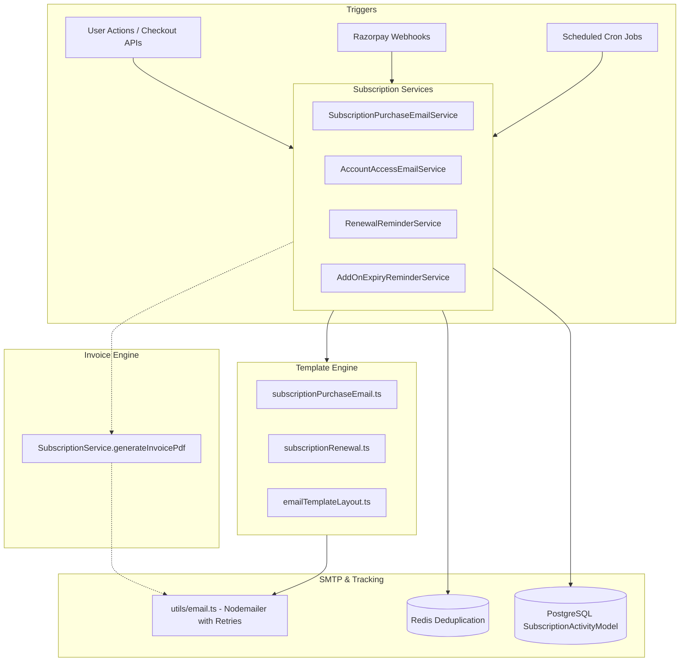

# Subscription & Add-On Email Functionality Documentation

This document provides comprehensive technical documentation for all email notifications, templates, delivery mechanisms, background jobs, and error handling related to the **Subscription and Add-on** modules in MediArogya.

---

## Table of Contents

1. [Architecture Overview](#1-architecture-overview)
2. [Source Code & File Map](#2-source-code--file-map)
3. [Email Service Layer](#3-email-service-layer)
   - [3.1 SubscriptionPurchaseEmailService](#31-subscriptionpurchaseemailservice)
   - [3.2 AccountAccessEmailService](#32-accountaccessemailservice)
   - [3.3 RenewalReminderService](#33-renewalreminderservice)
   - [3.4 AddOnExpiryReminderService](#34-addonexpiryreminderservice)
4. [Recipient Resolution & Role Targeting](#4-recipient-resolution--role-targeting)
5. [Subscription Email Flows & Templates](#5-subscription-email-flows--templates)
   - [5.1 Plan Purchase & Activation (Paid / Free / Trial)](#51-plan-purchase--activation-paid--free--trial)
   - [5.2 Plan Upgrades, Downgrades & Scheduled Changes](#52-plan-upgrades-downgrades--scheduled-changes)
   - [5.3 Scheduled Plan Change Reversal](#53-scheduled-plan-change-reversal)
   - [5.4 Billing Cycle Changes](#54-billing-cycle-changes)
   - [5.5 Subscription Renewal Reminders (7d, 3d, 1d, 0d)](#55-subscription-renewal-reminders-7d-3d-1d-0d)
   - [5.6 AutoPay (Mandate) Status Updates](#56-autopay-mandate-status-updates)
   - [5.7 AutoPay Recurring Payment Succeeded](#57-autopay-recurring-payment-succeeded)
   - [5.8 Recurring Payment Failed / AutoPay Halted](#58-recurring-payment-failed--autopay-halted)
   - [5.9 Checkout Incomplete & Payment Failure](#59-checkout-incomplete--payment-failure)
6. [Add-On Email Flows & Templates](#6-add-on-email-flows--templates)
   - [6.1 Add-On Purchase Confirmation](#61-add-on-purchase-confirmation)
   - [6.2 Add-On Renewal Cancellation](#62-add-on-renewal-cancellation)
   - [6.3 Add-On Quantity Reduction](#63-add-on-quantity-reduction)
   - [6.4 Add-On Expiry Reminders (7d, 3d, 1d, 0d)](#64-add-on-expiry-reminders-7d-3d-1d-0d)
   - [6.5 Add-On Expired & Deactivated](#65-add-on-expired--deactivated)
7. [Account Access & Staff Deactivation Warnings](#7-account-access--staff-deactivation-warnings)
   - [7.1 Advance Notice to Affected Doctors & Staff](#71-advance-notice-to-affected-doctors--staff)
   - [7.2 3-Day Countdown Reminder](#72-3-day-countdown-reminder)
   - [7.3 Access Restored (Downgrade Reversed) Notice](#73-access-restored-downgrade-reversed-notice)
8. [Email Design System & Layout Helpers](#8-email-design-system--layout-helpers)
9. [Automated PDF Invoice Attachments](#9-automated-pdf-invoice-attachments)
10. [Scheduled Background Jobs (Crons)](#10-scheduled-background-jobs-crons)
11. [Reliability, Deduplication & Idempotency](#11-reliability-deduplication--idempotency)
12. [Configuration & Environment Variables](#12-configuration--environment-variables)
13. [Testing & Verification Guide](#13-testing--verification-guide)

---

## 1. Architecture Overview

Email notifications in the MediArogya subscription and add-on ecosystem are triggered by three primary entry points:

1. **Synchronous HTTP Operations**: Immediate user actions such as plan purchases, add-on additions, manual plan changes, and cancellations.
2. **Asynchronous Razorpay Webhooks**: Automatic recurring payments (`subscription.charged`), recurring failures (`payment.failed`), mandate setup events (`subscription.authenticated`), and halted subscriptions (`subscription.halted`).
3. **Automated Cron Schedulers**: Time-based background jobs for advance expiration warnings, 3-day account access loss warnings, and automatic resource deactivation.



---

## 2. Source Code & File Map

| Component / Layer | File Path | Description |
| --- | --- | --- |
| **Email Service** | `src/main/subscription/services/subscriptionPurchaseEmail.service.ts` | Primary facade for all admin-facing subscription and add-on purchase, failure, and status emails. |
| **Account Access Email Service** | `src/main/subscription/services/accountAccessEmail.service.ts` | Dispatches warning and restoration notices directly to affected doctors and staff members. |
| **Plan Renewal Reminder Service** | `src/main/subscription/services/renewalReminder.service.ts` | Calculates calendar days to expiry in IST and sends renewal alerts at 7, 3, 1, and 0 days. |
| **Add-On Expiry Reminder Service** | `src/main/subscription/services/addOnExpiryReminder.service.ts` | Calculates add-on expiration milestones and triggers renewal notices. |
| **HTML Templates** | `src/htmltamplates/subscriptionPurchaseEmail.ts` | Contains 14 parameterized HTML email templates styled with the core branding. |
| **Renewal Template** | `src/htmltamplates/subscriptionRenewal.ts` | Rich plan renewal email template with plan quotas, add-on lists, and renewal CTA. |
| **Layout Helpers** | `src/htmltamplates/emailTemplateLayout.ts` | Base layout container, responsive email cards, alert boxes, CTA buttons, and footer. |
| **Invoice Generator** | `src/main/subscription/services/subscription.service.ts` | Produces branded PDF invoices dynamically attached to success emails. |
| **SMTP Dispatcher** | `src/utils/email.ts` | Nodemailer transporter with exponential backoff retry for transient SMTP errors. |
| **Cron Jobs** | `src/cron/jobs/subscriptionReminders.cron.ts`<br>`src/cron/jobs/accountAccessReminders.cron.ts`<br>`src/cron/jobs/expiredAddOns.cron.ts`<br>`src/cron/jobs/scheduledPlanChanges.cron.ts` | Background triggers for automated time-based notifications. |

---

## 3. Email Service Layer

### 3.1 SubscriptionPurchaseEmailService
*Location:* `src/main/subscription/services/subscriptionPurchaseEmail.service.ts`

Static service orchestrating communication directed to Clinic Administrators.

| Method | Parameters | Trigger Points |
| --- | --- | --- |
| `sendSuccess()` | `clinicId`, `subscriptionId`, `planName`, `amount`, `transactionId`, `paid?`, `trialDays?`, `trialEndsAt?`, `billingCycle?`, `addOns?` | Plan verification, combined checkout, free tier activation, recurring payments. |
| `sendFreeActivation()` | `clinicId`, `planName`, `isTrialPlan?`, `trialDays?`, `trialEndsAt?` | User registration / new clinic onboarding. |
| `sendFailure()` | `clinicId`, `itemName`, `amount?`, `reason?`, `droppedCheckout?`, `itemType?` | Checkout drops, payment signature failures, payment gateway errors. |
| `sendPlanChange()` | `clinicId`, `planName`, `effectiveAt`, `scheduled`, `fromBillingCycle?`, `billingCycle?`, `invoiceSubscriptionId?`, `accountImpact?` | Plan upgrades, downgrades, and monthly-to-yearly billing cycle switches. |
| `sendPlanChangeReversed()` | `clinicId`, `currentPlanName`, `cancelledPlanName` | Admin cancels a pending scheduled plan downgrade. |
| `sendRenewalSuccess()` | `clinicId`, `planName`, `amount`, `invoiceAmount?`, `transactionId`, `renewedUntil`, `billingCycle?` | Razorpay AutoPay recurring payment success (`subscription.charged`). |
| `sendRenewalFailure()` | `clinicId`, `planName`, `amount?`, `transactionId?`, `orderId?`, `reason`, `accessThrough`, `autopayHalted?`, `eventKey` | Webhooks `payment.failed` on recurring billing or `subscription.halted`. |
| `sendAutoRenewStatus()` | `clinicId`, `planName`, `billingCycle`, `status`, `effectiveAt`, `amount?`, `subscriptionUrl?` | AutoPay mandate initiation, verification, cancellation, or deactivation. |
| `sendAddOnPurchaseSuccess()` | `clinicId`, `transactionId`, `invoiceId`, `items`, `totalAmount` | Successful add-on checkout verification. |
| `sendAddOnCancellation()` | `clinicId`, `addOnName`, `effectiveAt`, `scheduled`, `quantity?` | Admin cancels add-on renewal or removes immediate add-on. |
| `sendAddOnQuantityReduction()` | `clinicId`, `addOnName`, `previousQuantity`, `newQuantity`, `effectiveAt` | Admin decreases seat/quantity for next billing cycle. |
| `sendAddOnExpiryReminder()` | `clinicId`, `addOnName`, `quantity`, `expiresAt`, `daysRemaining` | Daily 7:00 AM IST reminder cron. |
| `sendAddOnExpired()` | `clinicId`, `addOnName`, `quantity`, `expiredAt` | Hourly cron upon deactivating past-expiry add-on. |

### 3.2 AccountAccessEmailService
*Location:* `src/main/subscription/services/accountAccessEmail.service.ts`

Manages direct communications sent to individual doctors and staff members when clinic subscription changes alter their individual platform access.

- `notifyScheduledDeactivation()`: Dispatches initial warning email when admin schedules a downgrade or add-on seat reduction that requires deactivating selected users.
- `sendThreeDayReminders()`: Scans upcoming scheduled deactivations and sends a reminder exactly 3 calendar days before the effective deactivation date.
- `notifyDowngradeReversed()`: Notifies users when their scheduled deactivation is revoked due to the admin cancelling the downgrade.

### 3.3 RenewalReminderService
*Location:* `src/main/subscription/services/renewalReminder.service.ts`

Executes the daily check for clinic plan expirations:
- Evaluates dates in **Asia/Kolkata (IST)**.
- Sends structured reminders at **7, 3, 1, and 0 days** prior to expiry.
- **Consolidated Renewal Summary**: Merges base plan with all active add-ons into a single renewal bill:
  - Groups add-ons by feature/add-on type and sums quantities (e.g. `Additional Staff Member × 10`).
  - Uses full catalog renewal rates (`monthlyPrice` / `yearlyPrice` × `renewalQuantity`) matching `upcomingRenewal` in `/my-subscription`.
  - Respects cancellations (`cancelAtPeriodEnd = true`) and scheduled partial reductions via `addOnRenewalQuantity()`.
- Dynamically sets subject line to include `& Add-ons` when active add-ons exist.
- Emits simultaneous in-app notifications.

### 3.4 AddOnExpiryReminderService
*Location:* `src/main/subscription/services/addOnExpiryReminder.service.ts`

Originally created for standalone add-on expiration cycles:
- *Note on Cron Execution*: Disconnected from the daily 7:00 AM IST cron job to prevent sending duplicate notifications for the same renewal cycle. Because add-on billing aligns with the parent subscription period, all active add-ons are now consolidated into the single `RenewalReminderService` email.

---

## 4. Recipient Resolution & Role Targeting

### Clinic Administrator Lookup
For all subscription and add-on transactions, the primary recipient is determined by `getClinicAdmin(clinicId)`:
1. First checks `ClinicModel.userId == UserModel.id`.
2. If the creator has no valid email, queries `ClinicAssignModel` joined with `UserModel` where `UserModel.email` is not null.
3. Fallback ensures notifications reach the active clinic administrator even if user ownership was reassigned.

### Affected Staff & Doctor Resolution
When seat reductions or downgrades occur:
1. Selected user IDs stored in `deactivationNoticeUserIds` are resolved against `ClinicAssignModel` and `UserModel`.
2. Each user receives a personalized email addressed by their name (`userName`), role (`userType`), and clinic name (`clinicName`).

---

## 5. Subscription Email Flows & Templates

### 5.1 Plan Purchase & Activation (Paid / Free / Trial)

- **Template Function**: `subscriptionPurchaseSuccessTemplate`
- **Subjects**:
  - *Free Trial*: `MediArogya Free Trial Activated — <Plan Name>`
  - *Free Plan*: `MediArogya Subscription Activated — <Plan Name>`
  - *Paid Plan*: `MediArogya Subscription Purchase Successful — <Plan Name>`
- **Key Information Displayed**:
  - Greeting with Admin Name.
  - Plan name and clinic name.
  - Payment status, total amount paid in INR (`₹`), and Razorpay transaction ID.
  - Trial duration and expiry date (if free trial).
  - List of bundled add-ons purchased in the same transaction.
  - Call to Action button: "Go to Subscription Settings".
- **Attachment**: Generated PDF Invoice (`subscription_invoice_<id>.pdf`) automatically attached when `paid !== false`.

### 5.2 Plan Upgrades, Downgrades & Scheduled Changes

- **Template Function**: `subscriptionPlanChangeTemplate`
- **Subjects**:
  - *Immediate (Upgrade)*: `MediArogya Subscription Plan Change — <Plan Name>`
  - *Scheduled (Downgrade)*: `MediArogya Subscription Plan Change Scheduled — <Plan Name>`
- **Key Information Displayed**:
  - Upgrade vs Downgrade alert tone (`success` for immediate upgrade, `warning` for scheduled downgrade).
  - Effective date formatted in IST (`DD MMMM YYYY`).
  - Explanation of billing period continuity (current plan remains active until the end of the paid cycle).
  - **Account Impact Breakdown**:
    - List of continuing doctors and continuing staff.
    - List of scheduled deactivations for doctors and staff exceeding the new tier's quota.
- **Attachment**: Attached invoice if a billing cycle change charge was collected.

### 5.3 Scheduled Plan Change Reversal

- **Template Function**: `subscriptionPlanChangeReversedTemplate`
- **Subject**: `MediArogya Scheduled Plan Change Cancelled — <Cancelled Plan Name>`
- **Key Information Displayed**:
  - Notice confirming that the scheduled downgrade was revoked.
  - Confirmation that current plan (`currentPlanName`) continues uninterrupted.
  - Explicit confirmation that doctor and staff seats will **not** be deactivated.

### 5.4 Billing Cycle Changes

- **Template Function**: `subscriptionPlanChangeTemplate`
- **Trigger**: Switching from Monthly to Yearly (or vice versa).
- **Key Information Displayed**:
  - Summary of previous billing cycle vs new billing cycle.
  - Effective date and prorated invoice attachment.

### 5.5 Subscription Renewal Reminders (7d, 3d, 1d, 0d)

- **Template Function**: `subscriptionRenewalTemplate`
- **Subjects**:
  - *With active add-ons*: `MediArogya Subscription Expiry Reminder — <Plan Name> Plan & Add-ons Expire in <X> Day(s) at <Clinic Name>`
  - *Without add-ons*: `MediArogya Subscription Expiry Reminder — <Plan Name> Plan Expires in <X> Day(s) at <Clinic Name>`
- **Key Information Displayed**:
  - Days remaining and exact expiration date in IST.
  - Renewal price for the base plan's standard cycle.
  - **Current Usage Metrics vs Solo Limits**:
    - Doctor count vs free limit.
    - Staff count vs free limit.
  - **Active Add-Ons Breakdown (Consolidated)**:
    - Grouped by add-on type with total units (e.g. `Additional Staff Member × 10`).
    - Full catalog renewal pricing (`unitPrice × quantity`), avoiding mid-cycle prorated decimals.
    - Excludes items scheduled for cancellation (`cancelAtPeriodEnd = true`).
  - **Total Renewal Amount**: Base Plan Price + Total Active Add-Ons Renewal Amount.
  - CTA Button: Direct renewal deep-link (`${FRONTEND_URL}/subscription/renew?planId=...&cycle=...&clinicId=...`).

### 5.6 AutoPay (Mandate) Status Updates

- **Template Function**: `autoRenewStatusTemplate`
- **Subjects**:
  - `enabled`: `MediArogya AutoPay Enabled — <Plan Name>`
  - `payment_method_updated`: `MediArogya AutoPay Payment Method Updated — <Plan Name>`
  - `disabled`: `MediArogya AutoPay Turned Off — <Plan Name>`
  - `setup_cancelled`: `MediArogya Pending AutoPay Setup Cancelled — <Plan Name>`
- **When each is sent**:
  - No email is sent when a mandate is created: it is not active until the bank authorizes it, and it may never be.
  - `enabled` is sent once, when AutoPay actually switches on. The `subscription.authenticated` webhook, the client verify call and the status refresh can all switch it on; only the one that performs the off → on transition sends the email (`AutoRenewService.notifyAutoPayEnabled`).
  - `payment_method_updated` is sent once, when a replacement mandate takes over from the old one (`AutoRenewService.notifyAutoPayMethodReplaced`). Only the call that actually switched the record sends it, even though the webhook, the signed client callback and the status refresh can all reach that point. It is sent after the old mandate has been confirmed cancelled.
  - Buying a plan with AutoPay sends no AutoPay status email; the purchase receipt covers it.
- **Key Information Displayed**:
  - AutoPay state with corresponding alert styling.
  - Recurring charge amount and cycle frequency.
  - Effective billing date.
  - For `payment_method_updated`: the new payment method, and the previous one when known.
  - Management link to review or modify payment mandates.

### 5.7 AutoPay Recurring Payment Succeeded

- **Template Function**: `subscriptionRenewalPaymentSuccessTemplate`
- **Subject**: `MediArogya Subscription AutoPay Renewal Successful — <Plan Name>`
- **Key Information Displayed**:
  - Auto-renewal payment confirmation.
  - New subscription validity extension (`renewedUntil`).
  - Amount debited, Razorpay payment ID, and billing cycle.
- **Attachment**: Automatically generated renewal PDF invoice.

### 5.8 Recurring Payment Failed / AutoPay Halted

- **Template Function**: `subscriptionRenewalPaymentFailureTemplate`
- **Subjects**:
  - *Failure*: `MediArogya Recurring Payment Failed — <Plan Name>`
  - *Halted*: `MediArogya AutoPay Halted — <Plan Name>`
- **Key Information Displayed**:
  - Detailed error reason returned by Razorpay / issuing bank.
  - Grace period information (`accessThrough` date).
  - Explicit warning if AutoPay mandate was halted after multiple retry failures.
  - High-priority CTA button: "Update Payment Method".

### 5.9 Checkout Incomplete & Payment Failure

- **Template Function**: `subscriptionPurchaseFailureTemplate`
- **Subjects**:
  - *Dropped*: `MediArogya <Subscription/Add-on> Checkout Incomplete — <Item Name>`
  - *Failed*: `MediArogya <Subscription/Add-on> Payment Failed — <Item Name>`
- **Key Information Displayed**:
  - Explanatory message indicating whether the session was abandoned or rejected by the gateway.
  - Item name and intended purchase amount.
  - Reassurance that no funds were captured (or refund instruction if deducted).
  - CTA button to retry checkout.

---

## 6. Add-On Email Flows & Templates

### 6.1 Add-On Purchase Confirmation

- **Template Function**: `addOnPurchaseSuccessTemplate`
- **Subjects**:
  - *Single Item*: `MediArogya Add-on Activated — <Add-on Name>`
  - *Multiple Items*: `MediArogya Add-ons Activated — <Count> Add-ons`
- **Key Information Displayed**:
  - Itemized table of purchased add-ons with quantities, cycle (monthly/yearly), and amounts.
  - Total amount paid and transaction ID.
  - Confirmation of immediate resource limit expansion.
- **Attachment**: Add-on tax invoice PDF (`addon_invoice_<id>.pdf`).

### 6.2 Add-On Renewal Cancellation

- **Template Function**: `addOnCancellationTemplate`
- **Subjects**:
  - *Scheduled*: `MediArogya Add-on Renewal Cancellation Scheduled — <Add-on Name>`
  - *Immediate*: `MediArogya Add-on Cancellation Confirmed — <Add-on Name>`
- **Key Information Displayed**:
  - Add-on name and quantity being cancelled.
  - End of service date (`effectiveAt`).
  - Notice that resources remain active until the close of the current paid billing period.

### 6.3 Add-On Quantity Reduction

- **Template Function**: `addOnQuantityReductionTemplate`
- **Subject**: `MediArogya Add-on Quantity Reduction Scheduled — <Add-on Name>`
- **Key Information Displayed**:
  - Previous quantity vs new quantity for the next cycle.
  - Date when the quantity reduction takes effect.
  - Prompt to verify user assignment before excess seats are locked.

### 6.4 Add-On Expiry Reminders (7d, 3d, 1d, 0d)

- **Template Function**: `addOnExpiryReminderTemplate`
- **Subject**: `MediArogya Add-on <expires today / expires in X days> — <Add-on Name>`
- **Key Information Displayed**:
  - Add-on name, licensed quantity, and expiration date.
  - Days remaining with color-coded urgency box.
  - Direct link to add-on management screen to extend validity.

### 6.5 Add-On Expired & Deactivated

- **Template Function**: `addOnExpiredTemplate`
- **Subject**: `MediArogya Add-on Expired — <Add-on Name>`
- **Key Information Displayed**:
  - Notice that the add-on validity period has concluded.
  - Summary of deactivated extra capacity.
  - Link to purchase new add-on capacity.

---

## 7. Account Access & Staff Deactivation Warnings

When a clinic downgrades their tier or reduces add-on seat counts, the system prevents sudden lockout without advance warning.

```
+-----------------------------------------------------------------------------------+
| Timeline of Account Access Notifications                                          |
|                                                                                   |
|  [Day 0] Admin schedules downgrade / reduction                                    |
|          └──> notifyScheduledDeactivation() sent immediately to selected users.   |
|                                                                                   |
|  [T - 3 Days] Hourly cron checks pending schedules                                |
|          └──> sendThreeDayReminders() sent 3 calendar days prior to effective date|
|                                                                                   |
|  (Optional) If Admin cancels downgrade before effective date                      |
|          └──> notifyDowngradeReversed() sent to restore peace of mind.             |
|                                                                                   |
|  [Effective Date] Hourly cron deactivates users and terminates access.            |
+-----------------------------------------------------------------------------------+
```

### 7.1 Advance Notice to Affected Doctors & Staff
- **Template**: `accountAccessScheduledDeactivationTemplate`
- **Recipient**: Target user's personal email (Doctor or Staff member).
- **Subject**: `Important notice about your account access — <Clinic Name>`
- **Content**:
  - Addressed to user by name and clinic role.
  - Informs them that their login access will conclude on `effectiveAt`.
  - Explains that their clinical notes and patient records remain safe in the clinic database.
  - Advises contacting the Clinic Admin if this change was made in error.

### 7.2 3-Day Countdown Reminder
- **Trigger**: Checked hourly by `initAccountAccessReminders` against `istDateKeyAfterDays(now, 3)`.
- **Deduplication**: Verified against `SubscriptionActivityModel` stage `three_day_reminder`.
- **Content**: Re-alerts the affected individual with elevated urgency 72 hours prior to deactivation.

### 7.3 Access Restored (Downgrade Reversed) Notice
- **Template**: `accountAccessDowngradeReversedTemplate`
- **Subject**: `Your account access will continue — <Clinic Name>`
- **Content**:
  - Reassures user that the scheduled downgrade was cancelled.
  - Confirms their account access remains fully active with no interruption.

---

## 8. Email Design System & Layout Helpers

All email templates utilize a shared, responsive layout builder implemented in `src/htmltamplates/emailTemplateLayout.ts`.

### Layout Anatomy
1. **Container**: Centered 600px email container with soft outer background (`#f8fafc`).
2. **Brand Header**: MediArogya brand banner and logo mark.
3. **Personalized Greeting**: Friendly salutation (`Hi Dr. Sharma 👋`).
4. **Headline & Lead Text**: High-contrast summary of the event.
5. **Alert Boxes (`renderAlertBox`)**:
   - `success`: `#f1fffb` background, green border, checkmark icon.
   - `warning`: `#fff3eb` background, amber border, exclamation icon.
   - `info`: `#f3fbff` background, cyan/blue border, info icon.
   - `danger`: `#fff1f2` background, rose border, alert icon.
6. **Key-Value Details Card (`renderDetailsCard`)**: Clean alternating rows presenting transaction IDs, dates, quantities, and pricing.
7. **Action CTA (`renderActionButton`)**: Prominent bulletproof HTML button with hover state.
8. **Plain Text URL Fallback (`renderLinkFallback`)**: Accessible raw URL for email clients that strip HTML buttons.
9. **Footer Notes (`footerNotes.ts`)**: Support email (`support@medisetu.com`), support phone, copyright notice, and automated message disclaimer.
10. **XSS Protection**: All dynamic user and clinic names are sanitized through `escapeHtml()` entity replacement.

---

## 9. Automated PDF Invoice Attachments

When transactions succeed, the email service interfaces with `SubscriptionService.generateInvoicePdf()`:

- **Subscription Purchase & Renewals**:
  - Generates official GST tax invoice PDF.
  - Attached with filename `invoice_<invoiceNumber>.pdf`.
  - Content type: `application/pdf`.
- **Add-On Purchases**:
  - Generates itemized add-on purchase invoice.
  - Attached with filename `addon_invoice_<invoiceNumber>.pdf`.
- **Resilience Design**:
  - Invoice generation is wrapped in a dedicated `try / catch` block.
  - If PDF compilation fails (e.g., temporary rendering timeout), **the confirmation email still sends successfully** with an in-email notification stating: *"You can download your invoice anytime from subscription settings."*

---

## 10. Scheduled Background Jobs (Crons)

| Cron Job | File | Frequency | Timezone | Triggered Actions |
| --- | --- | --- | --- | --- |
| **Subscription Renewal Reminders** | `subscriptionReminders.cron.ts` | Daily at 7:00 AM (`0 7 * * *`) | `Asia/Kolkata` | `RenewalReminderService.sendExpiryReminders()`<br>*(Consolidated plan & active add-ons renewal email)* |
| **Account Access Warnings** | `accountAccessReminders.cron.ts` | Hourly (`0 * * * *`) | `Asia/Kolkata` | `AccountAccessEmailService.sendThreeDayReminders()` |
| **Expired Add-Ons Processor** | `expiredAddOns.cron.ts` | Hourly (`0 * * * *`) | `Asia/Kolkata` | `AddOnService.processExpiredAddOns()`<br>Sends `sendAddOnExpired()` |
| **Scheduled Plan Changes** | `scheduledPlanChanges.cron.ts` | Hourly (`0 * * * *`) | `Asia/Kolkata` | Applies plan downgrades whose effective date has passed. |

All hourly jobs use Redis distributed locks (`runOnce(taskName, 55 * 60, callback)`) to guarantee single-execution in multi-instance cluster deployments.

---

## 11. Reliability, Deduplication & Idempotency

### Non-Blocking Email Dispatch
Email delivery operations **never** interrupt or revert database transactions. All calls are wrapped in robust exception handlers:
- If SMTP drops connection or rejects credentials, error is logged with `logger.error()`, while payment records, subscriptions, and database state remain safely committed.

### Deduplication Strategies
To prevent spamming users across cron cycles or repeated webhook deliveries:

1. **Redis Expiration Keys**:
   - Renewal reminders: `renewal_reminder:<clinicId>:<subscriptionId>:<istExpiryDate>:<daysRemaining>` (TTL: 48h).
   - Add-on reminders: `addon_expiry_reminder:<clinicId>:<addOnId>:<expiryDate>:<daysRemaining>` (TTL: 15d).
2. **Database Event Keys (`SubscriptionActivityModel`)**:
   - Recurring payment failures check:
     ```sql
     metadata->>'renewalEmailEventKey' = eventKey
     ```
   - Account access notices check:
     ```sql
     metadata->>'eventId' = eventId AND metadata->>'stage' = stage AND metadata->>'userId' = userId
     ```

### SMTP Retries & Transient Error Handling
In `src/utils/email.ts`, transient network errors undergo automatic exponential backoff:
- **Eligible Error Codes**: `451`, `421`, `450`, `ETIMEDOUT`, `ECONNECTION`, `EMESSAGE`.
- **Retry Count**: Defaults to 3 attempts (`EMAIL_MAX_RETRIES`).
- **Backoff Base**: 500ms exponential increase (`EMAIL_RETRY_BASE_MS * 2^(attempt - 1)`).

---

## 12. Configuration & Environment Variables

Ensure the following environment variables are properly defined in `.env`:

```env
# ==========================================
# SMTP / EMAIL CONFIGURATION
# ==========================================
SMTP_HOST=smtp.gmail.com
SMTP_PORT=587
SMTP_USER=notifications@medisetu.com
SMTP_PASS=your-secure-app-password
SMTP_FROM="MediArogya" <no-reply@medisetu.com>

# Retry tuning
EMAIL_MAX_RETRIES=3
EMAIL_RETRY_BASE_MS=500

# ==========================================
# APPLICATION URLS
# ==========================================
FRONTEND_URL=https://app.medisetu.com

# ==========================================
# REDIS (Used for Deduplication & Schedulers)
# ==========================================
REDIS_HOST=127.0.0.1
REDIS_PORT=6379
```

---

## 13. Testing & Verification Guide

### 1. Template Integrity Verification
To verify that all HTML templates compile cleanly and produce valid HTML:
```bash
npx tsx src/scripts/verify-templates.ts
```

### 2. Live Renewal Email Test
To test the full rendering and SMTP dispatch of a renewal email to a test account:
```bash
npx tsx src/scripts/testRenewalEmail.ts
```

### 3. Verification Checklist for New Changes
When updating email logic or creating new subscription templates:
- [ ] Ensure all dynamic strings are sanitized using `escapeHtml()`.
- [ ] Verify that monetary values format via `toFixed(2)` and include currency symbol (`₹`).
- [ ] Confirm dates are formatted in Indian Standard Time (`Asia/Kolkata`).
- [ ] Wrap invoice generator calls in `try / catch` so missing PDFs do not crash email delivery.
- [ ] Check that `sendEmail` calls are non-blocking within transactional endpoints.
- [ ] Verify Redis or database deduplication key coverage for any cron or webhook email.
